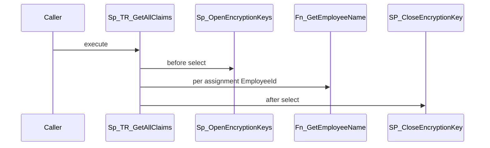
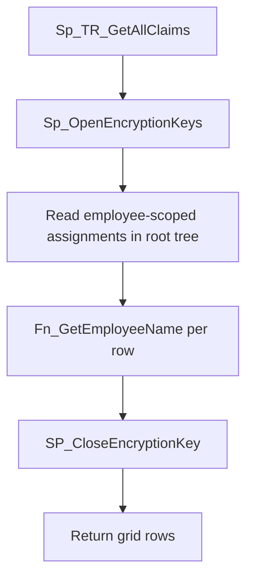

# Sp_TR_GetAllClaims

## What it does

Returns employee-scoped Training claim assignments for every employer under the same `RootEmployerId` as `@pEmployerId`. Opens encryption keys, builds employment number, display name, role name, claim text, and module id, then closes the encryption key. Training Permission Setup View Permission uses this grid.

## Parameters

| Name | Direction | What it is for |
|---|---|---|
| `@pEmployerId` | in | Employer used to resolve the root-employer tree |

## Call sequence

## Callers

No other procedure or function calls this object. App callers: `EmployeeDAL.GetAllClaims` → `employeeController.GetAllClaims` from [Training Permission Setup](/docs/guides/admin-configuration/training-permission-setup).

## Nested

| Object | Kind | When | Page |
|---|---|---|---|
| `Sp_OpenEncryptionKeys` | procedure | before the select | [Sp_OpenEncryptionKeys](/docs/database/hrms/Sp_OpenEncryptionKeys) |
| `Fn_GetEmployeeName` | function | for each assignment `EmployeeId` | [Fn_GetEmployeeName](/docs/database/hrms/Fn_GetEmployeeName) |
| `SP_CloseEncryptionKey` | procedure | after the select | [SP_CloseEncryptionKey](/docs/database/hrms/SP_CloseEncryptionKey) |

## Steps

1. Script is `HRMS-DATABASE/HRMS-TRAINING/STOREPROCEDURE/Sp_TR_GetAllClaims.sql`.
2. Execute synonym `Sp_OpenEncryptionKeys`.
3. Select from `TCLAIM_ASSIGNMENT` joined to `TCLAIM` where `EmployeeId > 0` and `Employerid` is in the set of employers sharing the same `RootEmployerId` as `@pEmployerId`.
4. Resolve `EmploymentNumber` from `TEmployeeInfo`, `EmployeeName` via `Fn_GetEmployeeName`, and `Role` via `TUsers` / `TRoles`.
5. Order by `EmployeeId`, `ClaimID`.
6. Execute synonym `SP_CloseEncryptionKey`.

## Tables

| Table | Read or write |
|---|---|
| `TCLAIM_ASSIGNMENT` | read |
| `TCLAIM` | read |
| `TEmployeeInfo` | read (TRAINING synonym) |
| `TUsers` | read (TRAINING synonym) |
| `TRoles` | read (TRAINING synonym) |
| `TEmployerDetails` | read (TRAINING synonym) |

## Unresolved calls

None.

## Flow

