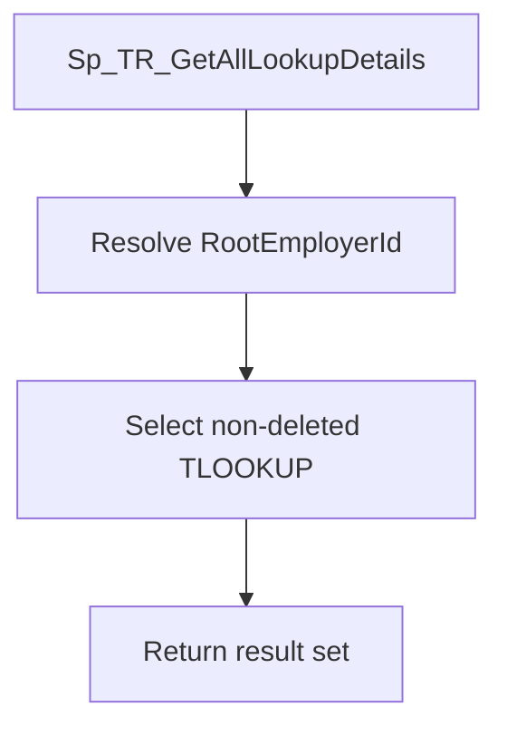

# Sp_TR_GetAllLookupDetails

## What it does

Returns every non-deleted Training `TLOOKUP` row for the caller's root employer, including parent text and `IsEditable`. Resolves `@pEmployerId` to `RootEmployerId` via the `TEmployerDetails` synonym when that employer has a root; otherwise uses the same id.

## Parameters

| Name | Direction | What it is for |
|---|---|---|
| `@pEmployerId` | in | Employer id from the UI; used to find the root employer scope |

## Call sequence

Calls no other procedures or functions.

## Callers

No other procedure or function in `HRMS-TRAINING` calls this object. Application caller: Training WebAPI `GetAllLookupDetails` (Common).

## Nested

Calls no other procedures or functions.

## Steps

1. Script is `HRMS-DATABASE/HRMS-TRAINING/STOREPROCEDURE/Sp_TR_GetAllLookupDetails.sql`.
2. Select `RootEmployerId` from `TEmployerDetails` where `Employerid = @pEmployerId`.
3. If that value is null, set `@RootEmployerID = @pEmployerId`.
4. Select from `TLOOKUP` where `isDeleted` is null/0 and `RootEmployerId = @RootEmployerID`, projecting `LookupId`, `LookupText`, `LookupParentId`, `SubParentId`, `SubChildId`, parent `LookupParentText`, and `IsEditable`.

## Tables

| Table | Read or write |
|---|---|
| `dbo.TEmployerDetails` | read (Training synonym to core HRMS) |
| `dbo.TLOOKUP` | read |

## Flow

