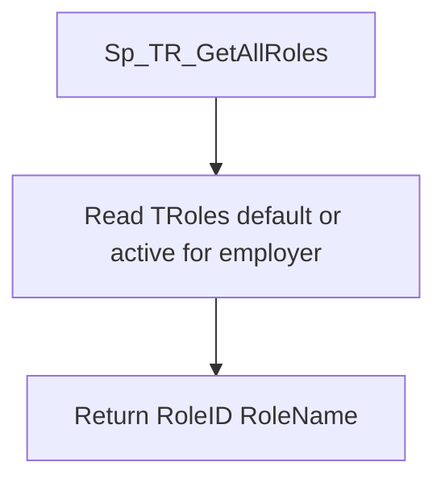

# Sp_TR_GetAllRoles

## What it does

Returns `RoleID` and `RoleName` from `TRoles` for default roles (`IsDefault = 1`) or active roles for the requested employer. Training Permission Setup uses the list for the Setup Permission role dropdown.

## Parameters

| Name | Direction | What it is for |
|---|---|---|
| `@pEmployerId` | in | Employer whose active roles are listed, plus default roles |

## Call sequence

Calls no other procedures or functions.

## Callers

No other procedure or function calls this object. App callers: `EmployeeDAL.GetAllRoles` → `employeeController.GetAllRoles` from [Training Permission Setup](/docs/guides/admin-configuration/training-permission-setup).

## Nested

Calls no other procedures or functions.

## Steps

1. Script is `HRMS-DATABASE/HRMS-TRAINING/STOREPROCEDURE/Sp_TR_GetAllRoles.sql`.
2. Select `RoleID`, `RoleName` from `[dbo].[TRoles]` where `IsDefault = 1` or (`IsActive = 'Y'` and `Employerid = @pEmployerId`).

## Tables

| Table | Read or write |
|---|---|
| `TRoles` | read (TRAINING synonym to HRMS `TRoles`) |

## Unresolved calls

None.

## Flow

