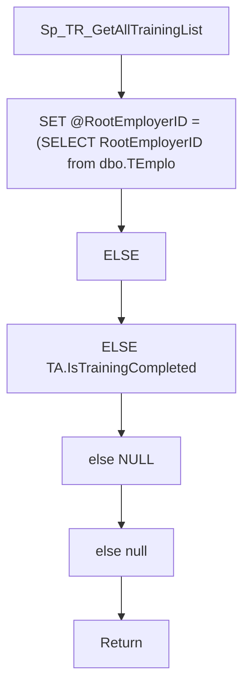

# Sp_TR_GetAllTrainingList

## What it does

Stored procedure `Sp_TR_GetAllTrainingList`. Calls no other procedure or function. Touches `TEmployerDetails`, `STRING_SPLIT`, `TLOOKUP`, `TTrainers`, `TTrainingDocuments`, `TTrainingSession`, `TAssignment`, `TTraining`.

## Parameters

| Name | Direction | What it is for |
|---|---|---|
| `@pEmployerId` | in | VARCHAR(5000) |
| `@pEmployeeId` | in | INT |
| `@pYear` | in | VARCHAR(200) |
| `@pQuarter` | in | VARCHAR(200) |
| `@pISClrTR` | in | BIT |
| `@pIsOlTR` | in | BIT |
| `@pIsUpcomingTR` | in | BIT |
| `@BusinessUnits` | in | VARCHAR(MAX) |
| `@ProductIds` | in | VARCHAR(MAX) |
| `@TrainingCategories` | in | VARCHAR(MAX) |
| `@TrainingSubCategories` | in | VARCHAR(MAX) |
| `@Month` | in | varchar(100) |
| `@FromDate` | in | DATE |
| `@ToDate` | in | DATE |
| `@SortingType` | in | VARCHAR(MAX) |
| `@SortingOrder` | in | VARCHAR(MAX) |

## Call sequence

Calls no other procedures or functions.

## Callers

No other procedure or function calls this object.

## Nested

Calls no other procedures or functions.

## Steps

1. Script is `HRMS-DATABASE/HRMS-TRAINING/STOREPROCEDURE/Sp_TR_GetAllTrainingList.sql`.
2. `SET @RootEmployerID = (SELECT RootEmployerID from dbo.TEmployerDetails WITH(NOLOCK) WHERE employerid =`
3. `ELSE`
4. `ELSE TA.IsTrainingCompleted`
5. `else NULL`
6. `else null`

## Tables

| Table | Read or write |
|---|---|
| `TEmployerDetails` | read |
| `STRING_SPLIT` | read |
| `TLOOKUP` | read |
| `TTrainers` | read |
| `TTrainingDocuments` | read |
| `TTrainingSession` | read |
| `TAssignment` | read |
| `TTraining` | read |
| `TTrainingProductMapping` | read |

## Flow

