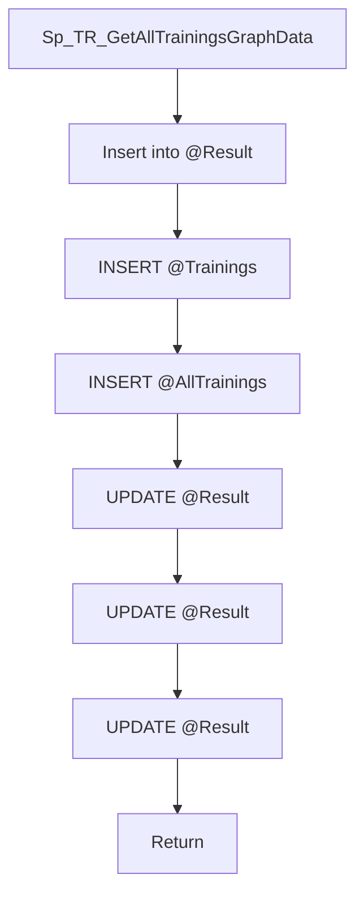

# Sp_TR_GetAllTrainingsGraphData

## What it does

Stored procedure `Sp_TR_GetAllTrainingsGraphData`. Calls no other procedure or function. Touches `TAssignment`, `TTraining`, `TLOOKUP`, `TEmployerDetails`.

## Parameters

| Name | Direction | What it is for |
|---|---|---|
| `@pEmployerId` | in | int |
| `@pEmployeeId` | in | int |

## Call sequence

Calls no other procedures or functions.

## Callers

No other procedure or function calls this object.

## Nested

Calls no other procedures or functions.

## Steps

1. Script is `HRMS-DATABASE/HRMS-TRAINING/STOREPROCEDURE/Sp_TR_GetAllTrainingsGraphData.sql`.
2. `Insert into @Result`
3. `INSERT @Trainings`
4. `INSERT @AllTrainings`
5. `UPDATE @Result`
6. `UPDATE @Result`
7. `UPDATE @Result`
8. `UPDATE @Result`

## Tables

| Table | Read or write |
|---|---|
| `TAssignment` | read |
| `TTraining` | read |
| `TLOOKUP` | read |
| `TEmployerDetails` | read |

## Flow

