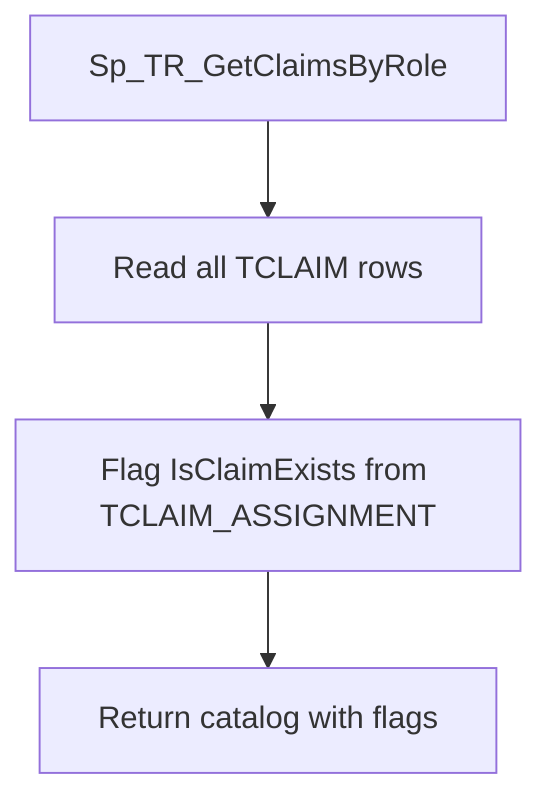

# Sp_TR_GetClaimsByRole

## What it does

Returns every Training claim from `TCLAIM` with an `IsClaimExists` bit from `TCLAIM_ASSIGNMENT`. When `@pSearchType` is `R`, existence is matched on `RoleId` and employer. When it is `E`, existence is matched on `EmployeeId` and employer. Training Permission Setup loads checkboxes through `GetClaimsBySearchType`, which executes this procedure.

## Parameters

| Name | Direction | What it is for |
|---|---|---|
| `@pRoleId` | in | Role id when `@pSearchType` is `R`. Default null |
| `@pEmployerId` | in | Employer on `TCLAIM_ASSIGNMENT.Employerid` |
| `@pSearchType` | in | `R` for role mode, `E` for employee mode |
| `@pEmployeeId` | in | Employee id when `@pSearchType` is `E`. Default null |

## Call sequence

Calls no other procedures or functions.

## Callers

No other procedure or function calls this object. App callers: `EmployeeDAL.GetClaimsBySearchType` / `GetClaimsByRole` → `employeeController.GetClaimsBySearchType` from [Training Permission Setup](/docs/guides/admin-configuration/training-permission-setup).

## Nested

Calls no other procedures or functions.

## Steps

1. Script is `HRMS-DATABASE/HRMS-TRAINING/STOREPROCEDURE/Sp_TR_GetClaimsByRole.sql`.
2. Select `ClaimID`, `ClaimText`, `ClaimText_Short` as `ClaimShortText`, `ModuleID` from `TCLAIM`.
3. Set `IsClaimExists` to 1 when a `TCLAIM_ASSIGNMENT` row exists for that claim, the same employer, and either `@pRoleId` (`R`) or `@pEmployeeId` (`E`).

## Tables

| Table | Read or write |
|---|---|
| `TCLAIM` | read |
| `TCLAIM_ASSIGNMENT` | read |

## Unresolved calls

None.

## Flow

