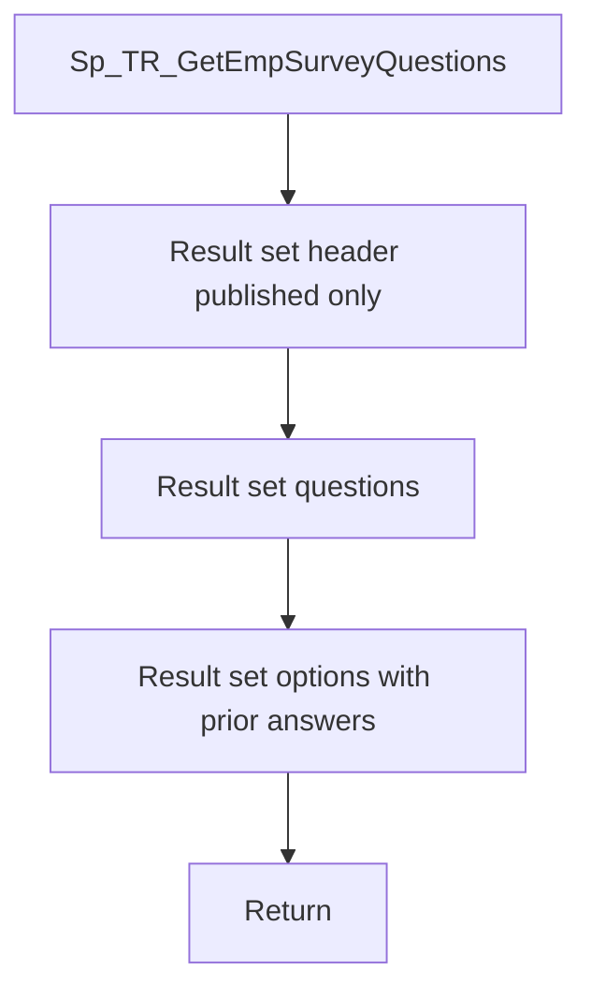

# Sp_TR_GetEmpSurveyQuestions

## What it does

Loads the employee take-survey payload for one published survey as three result sets: (1) year/quarter, derived `IsActive`, and `IsSubmitted` for the employee; (2) linked questions; (3) options with any prior employee selections. Header row requires `IsPublished = 1`.

## Parameters

| Name | Direction | What it is for |
|---|---|---|
| `@pSurveyId` | in | `TrainingSurveyID` |
| `@pEmployeeId` | in | Employee answering (or reviewing) |

## Call sequence

Calls no other procedures or functions.

## Callers

No other procedure or function calls this object.

## Nested

Calls no other procedures or functions.

## Steps

1. Script is `HRMS-DATABASE/HRMS-TRAINING/STOREPROCEDURE/Sp_TR_GetEmpSurveyQuestions.sql`.
2. `SET NOCOUNT ON`.
3. Result set 1 — from `TTrainingSurvey` where id matches and `IsPublished = 1`; derive `IsActive` from `OpenTill`; derive `IsSubmitted` from existence of `TTrainingSurvey_Emp` rows for this employee’s survey questions.
4. Result set 2 — `TTrainingSurveyQuestions` joined to `TQuestion` for that survey.
5. Result set 3 — `TQuestionOption` for those questions, with `EmpSelectedOption` / `EmpAnswerText` from `TTrainingSurvey_Emp`.

## Tables

| Table | Read or write |
|---|---|
| `TTrainingSurvey` | read |
| `TTrainingSurveyQuestions` | read |
| `TQuestion` | read |
| `TQuestionOption` | read |
| `TTrainingSurvey_Emp` | read |

## Flow

