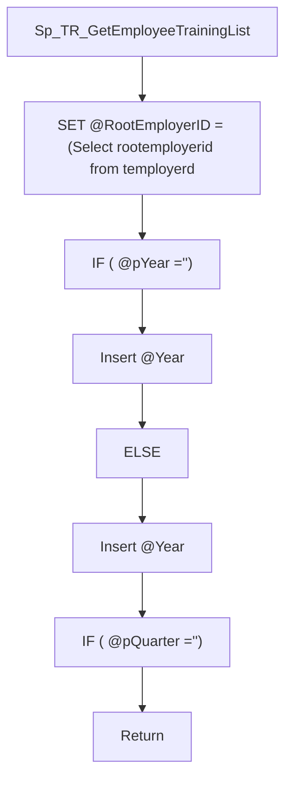

# Sp_TR_GetEmployeeTrainingList

## What it does

Stored procedure `Sp_TR_GetEmployeeTrainingList`. Calls no other procedure or function. Touches `temployerdetails`, `TTraining`, `String_Split`, `TAssignment`, `TLOOKUP`, `TTrainers`, `TTrainingDocuments`, `TTrainingSession`.

## Parameters

| Name | Direction | What it is for |
|---|---|---|
| `@pEmployeeId` | in | int |
| `@pEmployerId` | in | varchar(500) |
| `@pQuarter` | in | varchar(100) |
| `@pYear` | in | varchar(100) |
| `@pISClrTR` | in | bit |
| `@pIsOlTR` | in | bit |
| `@pIsUpcomingTR` | in | bit |
| `@pIsMandatoryTR` | in | bit |
| `@pIsOptionalTR` | in | bit |
| `@pIsCompletedTR` | in | bit |
| `@Month` | in | varchar(100) |
| `@FromDate` | in | DATE |
| `@ToDate` | in | DATE |
| `@SortingType` | in | VARCHAR(MAX) |
| `@SortingOrder` | in | VARCHAR(MAX) |

## Call sequence

Calls no other procedures or functions.

## Callers

No other procedure or function calls this object.

## Nested

Calls no other procedures or functions.

## Steps

1. Script is `HRMS-DATABASE/HRMS-TRAINING/STOREPROCEDURE/Sp_TR_GetEmployeeTrainingList.sql`.
2. `SET @RootEmployerID = (Select rootemployerid from temployerdetails where employerid = @pEmployerId)`
3. `IF ( @pYear ='')`
4. `Insert @Year`
5. `ELSE`
6. `Insert @Year`
7. `IF ( @pQuarter ='')`
8. `Insert @Quarter values (1),(2),(3),(4)`
9. `ELSE`
10. `Insert @Quarter`
11. `Insert @EmployerId`
12. `IF (@pISClrTR = 0 AND @pIsOlTR = 0 AND @pIsUpcomingTR = 0 AND @pIsMandatoryTR = 0 AND @pIsOptionalTR = 0 AND @pIsCompletedTR = 0)`
13. `INSERT @TrainingIDs`
14. `IF (@pISClrTR = 1)`
15. `INSERT @TrainingIDs`
16. `IF (@pIsOlTR = 1)`
17. `INSERT @TrainingIDs`
18. `IF (@pIsMandatoryTR = 1)`
19. `INSERT @TrainingIDs`

## Tables

| Table | Read or write |
|---|---|
| `temployerdetails` | read |
| `TTraining` | read |
| `String_Split` | read |
| `TAssignment` | read |
| `TLOOKUP` | read |
| `TTrainers` | read |
| `TTrainingDocuments` | read |
| `TTrainingSession` | read |
| `TOnlineTrainingCompletion` | read |
| `TDOCUMENTS` | read |
| `TATTENDANCE` | read |
| `TWaiver` | read |
| `TTRAININGSESSION` | read |
| `TFEEDBACK_EMP` | read |
| `STRING_SPLIT` | read |

## Flow

