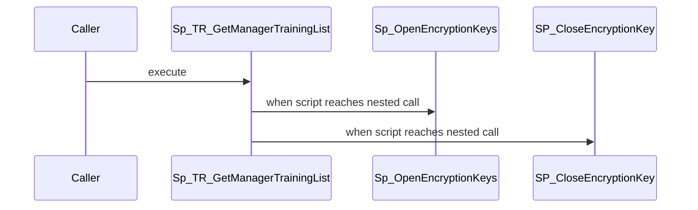
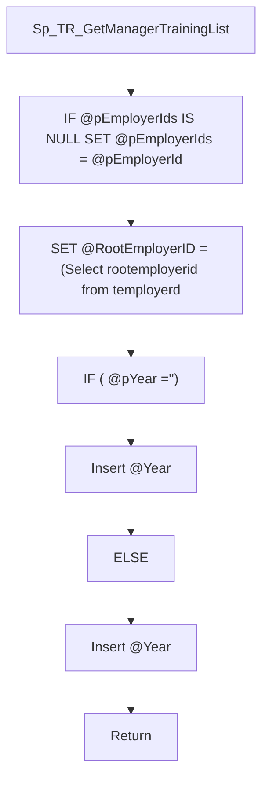

# Sp_TR_GetManagerTrainingList

## What it does

Stored procedure `Sp_TR_GetManagerTrainingList`. Calls `Sp_OpenEncryptionKeys`, `SP_CloseEncryptionKey`. Touches `temployerdetails`, `String_Split`, `TTraining`, `TEmployeeInfo`, `TEMPLOYEE`, `TLOOKUP`, `TAssignment`, `TEMPLOYEEINFO`.

## Parameters

| Name | Direction | What it is for |
|---|---|---|
| `@pEmployerId` | in | varchar(5000) |
| `@pEmployeeId` | in | Int |
| `@pYear` | in | varchar(200) |
| `@pQuarter` | in | varchar(200) |
| `@pISClrTR` | in | bit |
| `@pIsOlTR` | in | bit |
| `@pIsUpcomingTR` | in | bit |
| `@pBusinessUnit` | in | varchar(100) |
| `@pEmployerIds` | in | VARCHAR(MAX) |

## Call sequence

## Callers

No other procedure or function calls this object.

## Nested

| Object | Kind | When | Page |
|---|---|---|---|
| `Sp_OpenEncryptionKeys` | procedure | when script executes it | [Sp_OpenEncryptionKeys](/docs/database/hrms/Sp_OpenEncryptionKeys) |
| `SP_CloseEncryptionKey` | procedure | when script executes it | [SP_CloseEncryptionKey](/docs/database/hrms/SP_CloseEncryptionKey) |

## Steps

1. Script is `HRMS-DATABASE/HRMS-TRAINING/STOREPROCEDURE/Sp_TR_GetManagerTrainingList.sql`.
2. `IF @pEmployerIds IS NULL SET @pEmployerIds = @pEmployerId`
3. `SET @RootEmployerID = (Select rootemployerid from temployerdetails where employerid = (`
4. `IF ( @pYear ='')`
5. `Insert @Year`
6. `ELSE`
7. `Insert @Year`
8. `IF ( @pBusinessUnit ='' or @pBusinessUnit is null)`
9. `Insert @BusinessUnit`
10. `ELSE`
11. `Insert @BusinessUnit`
12. `IF ( @pQuarter ='')`
13. `Insert @Quarter values (1),(2),(3),(4)`
14. `ELSE`
15. `Insert @Quarter`
16. `Insert @EmployerId`
17. `IF (@pISClrTR = 0 AND @pIsOlTR = 0)`
18. `INSERT @TrainingIDs`
19. `IF (@pISClrTR = 1)`

## Tables

| Table | Read or write |
|---|---|
| `temployerdetails` | read |
| `String_Split` | read |
| `TTraining` | read |
| `TEmployeeInfo` | read |
| `TEMPLOYEE` | read |
| `TLOOKUP` | read |
| `TAssignment` | read |
| `TEMPLOYEEINFO` | read |
| `TORGChart` | read |

## Flow

