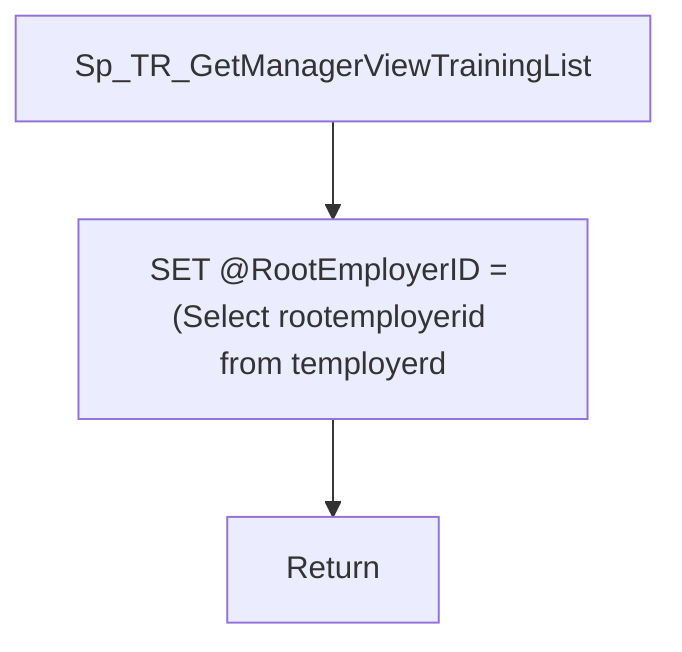

# Sp_TR_GetManagerViewTrainingList

## What it does

Stored procedure `Sp_TR_GetManagerViewTrainingList`. Calls no other procedure or function. Touches `temployerdetails`, `TASSIGNMENT`, `TEMPLOYEEINFO`, `TORGCHART`, `TLOOKUP`, `TTRAINING`.

## Parameters

| Name | Direction | What it is for |
|---|---|---|
| `@pEmployeeId` | in | int |
| `@pEmployerId` | in | int |

## Call sequence

Calls no other procedures or functions.

## Callers

No other procedure or function calls this object.

## Nested

Calls no other procedures or functions.

## Steps

1. Script is `HRMS-DATABASE/HRMS-TRAINING/STOREPROCEDURE/Sp_TR_GetManagerViewTrainingList.sql`.
2. `SET @RootEmployerID = (Select rootemployerid from temployerdetails where employerid= @pEmployerId)`

## Tables

| Table | Read or write |
|---|---|
| `temployerdetails` | read |
| `TASSIGNMENT` | read |
| `TEMPLOYEEINFO` | read |
| `TORGCHART` | read |
| `TLOOKUP` | read |
| `TTRAINING` | read |

## Flow

