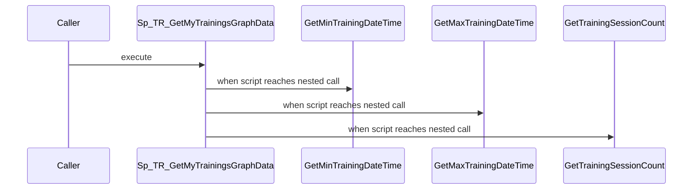
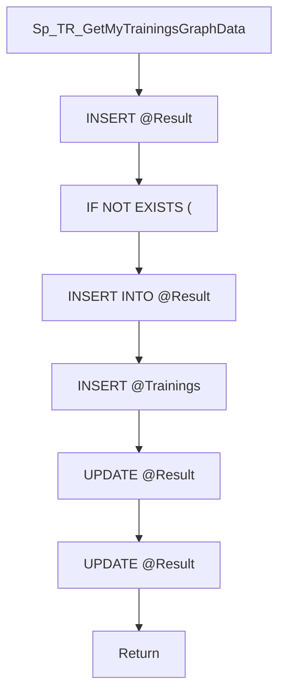

# Sp_TR_GetMyTrainingsGraphData

## What it does

Stored procedure `Sp_TR_GetMyTrainingsGraphData`. Calls `GetMinTrainingDateTime`, `GetMaxTrainingDateTime`, `GetTrainingSessionCount`. Touches `TTNI_EmployeeGoalSetup`, `TTNI_TrainingHourInfo`, `TAssignment`, `TTraining`, `TTrainingSession`, `TATTENDANCE`, `TOnlineTrainingCompletion`, `TAttendance`.

## Parameters

| Name | Direction | What it is for |
|---|---|---|
| `@pEmployerId` | in | INT |
| `@pEmployeeId` | in | INT |

## Call sequence

## Callers

No other procedure or function calls this object.

## Nested

| Object | Kind | When | Page |
|---|---|---|---|
| `GetMinTrainingDateTime` | function | when script executes it | [GetMinTrainingDateTime](/docs/database/hrms-training/GetMinTrainingDateTime) |
| `GetMaxTrainingDateTime` | function | when script executes it | [GetMaxTrainingDateTime](/docs/database/hrms-training/GetMaxTrainingDateTime) |
| `GetTrainingSessionCount` | function | when script executes it | [GetTrainingSessionCount](/docs/database/hrms-training/GetTrainingSessionCount) |

## Steps

1. Script is `HRMS-DATABASE/HRMS-TRAINING/STOREPROCEDURE/Sp_TR_GetMyTrainingsGraphData.sql`.
2. `INSERT @Result`
3. `IF NOT EXISTS (`
4. `INSERT INTO @Result`
5. `INSERT @Trainings`
6. `UPDATE @Result`
7. `UPDATE @Result`
8. `INSERT @TrainingsOnlineCount`
9. `INSERT @TrainingsClassRoomCount`
10. `SELECT @Count = ISNULL(SUM(IsTrainingCompleted),0) FROM @TrainingsClassRoomCount`
11. `UPDATE @Result SET ClassRoomCompleted = @Count`
12. `SELECT @Count = ISNULL(SUM(NotStarted),0) FROM @TrainingsClassRoomCount`
13. `UPDATE @Result SET ClassRoomNotStarted = @Count`
14. `SELECT @Count = ISNULL(SUM(InProgress),0) FROM @TrainingsClassRoomCount`
15. `UPDATE @Result SET ClassRoomInProgress = @Count`
16. `SELECT @Count = ISNULL(SUM(NotAttended),0) FROM @TrainingsClassRoomCount`
17. `UPDATE @Result SET ClassRoomNotAttended = @Count`
18. `SELECT @Count = ISNULL(SUM(PartiallyAttended),0) FROM @TrainingsClassRoomCount`
19. `UPDATE @Result SET ClassRoomPartiallyAttended = @Count`

## Tables

| Table | Read or write |
|---|---|
| `TTNI_EmployeeGoalSetup` | read |
| `TTNI_TrainingHourInfo` | read |
| `TAssignment` | read |
| `TTraining` | read |
| `TTrainingSession` | read |
| `TATTENDANCE` | read |
| `TOnlineTrainingCompletion` | read |
| `TAttendance` | read |
| `TMiscellaneousTrainings` | read |
| `STRING_SPLIT` | read |
| `TOrgHierarchyDetails` | read |
| `TEmployeeInfo` | read |

## Flow

