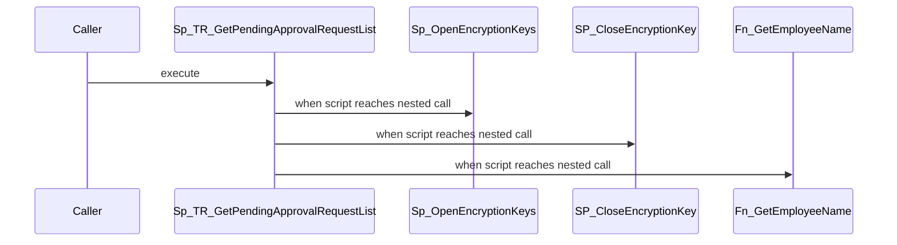
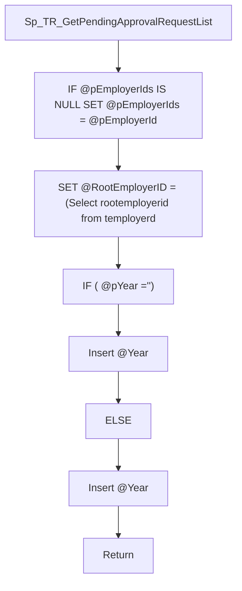

# Sp_TR_GetPendingApprovalRequestList

## What it does

Stored procedure `Sp_TR_GetPendingApprovalRequestList`. Calls `Sp_OpenEncryptionKeys`, `SP_CloseEncryptionKey`, `Fn_GetEmployeeName`. Touches `temployerdetails`, `String_Split`, `TTraining`, `TEmployeeInfo`, `Temployee`, `TORGChart`, `TLOOKUP`, `TEmployerDetails`.

## Parameters

| Name | Direction | What it is for |
|---|---|---|
| `@pEmployerId` | in | varchar(200) |
| `@pYear` | in | varchar(200) |
| `@pQuarter` | in | varchar(200) |
| `@pISClrTR` | in | bit |
| `@pIsOlTR` | in | bit |
| `@pBusinessUnit` | in | varchar(100) |
| `@pEmployerIds` | in | VARCHAR(MAX) |

## Call sequence

## Callers

No other procedure or function calls this object.

## Nested

| Object | Kind | When | Page |
|---|---|---|---|
| `Sp_OpenEncryptionKeys` | procedure | when script executes it | [Sp_OpenEncryptionKeys](/docs/database/hrms/Sp_OpenEncryptionKeys) |
| `SP_CloseEncryptionKey` | procedure | when script executes it | [SP_CloseEncryptionKey](/docs/database/hrms/SP_CloseEncryptionKey) |
| `Fn_GetEmployeeName` | function | when script executes it | [Fn_GetEmployeeName](/docs/database/hrms/Fn_GetEmployeeName) |

## Steps

1. Script is `HRMS-DATABASE/HRMS-TRAINING/STOREPROCEDURE/Sp_TR_GetPendingApprovalRequestList.sql`.
2. `IF @pEmployerIds IS NULL SET @pEmployerIds = @pEmployerId`
3. `SET @RootEmployerID = (Select rootemployerid from temployerdetails where employerid = (`
4. `IF ( @pYear ='')`
5. `Insert @Year`
6. `ELSE`
7. `Insert @Year`
8. `IF (@pQuarter ='')`
9. `Insert @Quarter values (1),(2),(3),(4)`
10. `ELSE`
11. `Insert @Quarter`
12. `IF (@pISClrTR = 0 AND @pIsOlTR = 0)`
13. `INSERT @TrainingIDs`
14. `IF (@pISClrTR = 1)`
15. `INSERT @TrainingIDs`
16. `IF (@pIsOlTR = 1)`
17. `INSERT @TrainingIDs`
18. `IF (@pBusinessUnit != '' OR @pBusinessUnit IS NOT NULL)`
19. `Insert @BusinessUnit`

## Tables

| Table | Read or write |
|---|---|
| `temployerdetails` | read |
| `String_Split` | read |
| `TTraining` | read |
| `TEmployeeInfo` | read |
| `Temployee` | read |
| `TORGChart` | read |
| `TLOOKUP` | read |
| `TEmployerDetails` | read |
| `TAssignment` | read |

## Flow

