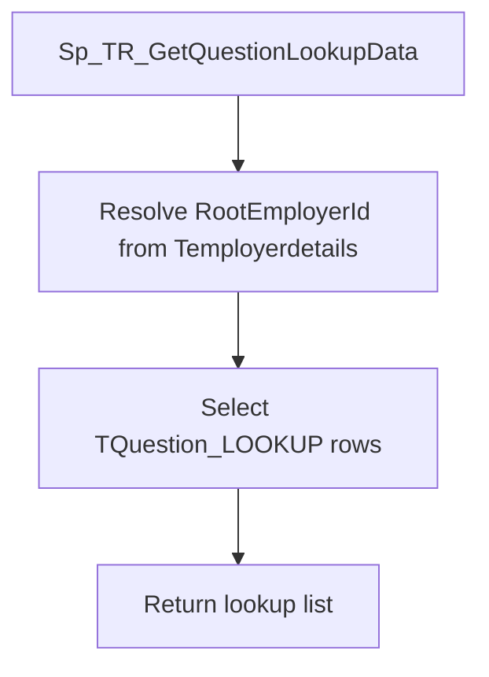

# Sp_TR_GetQuestionLookupData

## What it does

Returns non-deleted `TQuestion_LOOKUP` rows for the root employer of the given employer id (LookupId, LookupText, parent ids/text, IsEditable). Survey Analytics calls this through the Survey database synonym `Sp_TR_GetQuestionLookupData` → `Training.dbo.Sp_TR_GetQuestionLookupData` with `moduleId=17` from the UI; the Liquibase Training script declares only `@pRootEmployerID`.

## Parameters

| Name | Direction | What it is for |
|---|---|---|
| `@pRootEmployerID` | in | Employer id used to resolve RootEmployerID (or the employer itself when root is null) |

## Call sequence

Calls no other procedures or functions.

## Callers

No other procedure or function in Training calls this object. Survey app caller: `surveyDAL.GetQuestionLookupData` via Survey synonym. HRMS also has synonym `Sp_TR_GetQuestionLookupData`.

## Nested

Calls no other procedures or functions.

## Steps

In `HRMS-DATABASE/HRMS-TRAINING/STOREPROCEDURE/Sp_TR_GetQuestionLookupData.sql`:

1. Select LookupId / LookupText / LookupParentId / SubParentId / LookupParentText / IsEditable from `TQuestion_LOOKUP` where `isDeleted` is 0 or null.
2. Restrict `RootEmployerId` to the `RootEmployerID` (else `employerid`) from `Temployerdetails` for `@pRootEmployerID`.

## Tables

| Table | Read or write |
|---|---|
| `dbo.TQuestion_LOOKUP` | read |
| `dbo.Temployerdetails` | read |

## Flow

