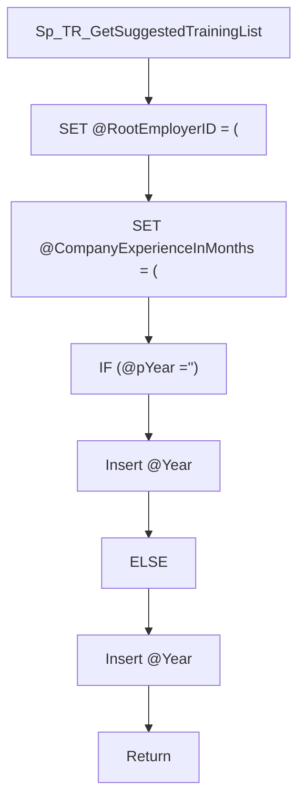

# Sp_TR_GetSuggestedTrainingList

## What it does

Stored procedure `Sp_TR_GetSuggestedTrainingList`. Calls no other procedure or function. Touches `temployerdetails`, `TEmployeeInfo`, `TTraining`, `String_Split`, `TTNI_TrainingHourInfo`, `TTNI_EmployeeGoalSetup`, `TLOOKUP`, `TTrainers`.

## Parameters

| Name | Direction | What it is for |
|---|---|---|
| `@pEmployerId` | in | varchar(5000) |
| `@pEmployeeId` | in | Int |
| `@pYear` | in | varchar(200) |
| `@pQuarter` | in | varchar(200) |
| `@pISClrTR` | in | bit |
| `@pIsOlTR` | in | bit |
| `@pIsUpcomingTR` | in | bit |
| `@SortingType` | in | VARCHAR(MAX) |
| `@SortingOrder` | in | VARCHAR(MAX) |

## Call sequence

Calls no other procedures or functions.

## Callers

No other procedure or function calls this object.

## Nested

Calls no other procedures or functions.

## Steps

1. Script is `HRMS-DATABASE/HRMS-TRAINING/STOREPROCEDURE/Sp_TR_GetSuggestedTrainingList.sql`.
2. `SET @RootEmployerID = (`
3. `SET @CompanyExperienceInMonths = (`
4. `IF (@pYear ='')`
5. `Insert @Year`
6. `ELSE`
7. `Insert @Year`
8. `IF (@pQuarter ='')`
9. `Insert @Quarter values (1),(2),(3),(4)`
10. `ELSE`
11. `Insert @Quarter`
12. `Insert @EmployerId`
13. `IF (@pISClrTR = 0 AND @pIsOlTR = 0)`
14. `INSERT @TrainingIDs`
15. `IF (@pISClrTR = 1)`
16. `INSERT @TrainingIDs`
17. `IF (@pIsOlTR = 1)`
18. `INSERT @TrainingIDs`
19. `INSERT @TrainingHours`

## Tables

| Table | Read or write |
|---|---|
| `temployerdetails` | read |
| `TEmployeeInfo` | read |
| `TTraining` | read |
| `String_Split` | read |
| `TTNI_TrainingHourInfo` | read |
| `TTNI_EmployeeGoalSetup` | read |
| `TLOOKUP` | read |
| `TTrainers` | read |
| `TTrainingDocuments` | read |
| `TTrainingSession` | read |
| `TAssignment` | read |
| `STRING_SPLIT` | read |

## Flow

