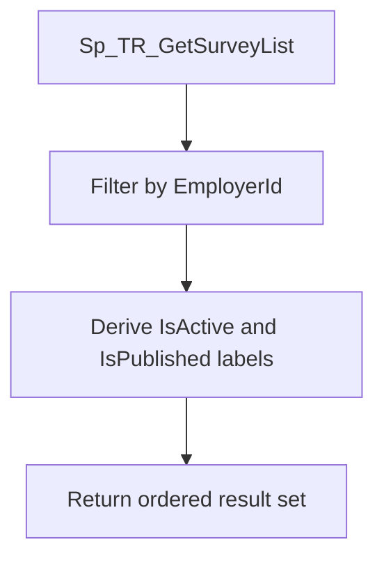

# Sp_TR_GetSurveyList

## What it does

Returns the LMS Training Survey Setup grid for one employer: survey id, year, quarter, valid-till (`OpenTill`), derived Active/InActive status, Yes/No publish flag, and created date. Rows are newest `TrainingSurveyID` first.

## Parameters

| Name | Direction | What it is for |
|---|---|---|
| `@pEmployerId` | in | Employer whose `TTrainingSurvey` rows are listed |

## Call sequence

Calls no other procedures or functions.

## Callers

No other procedure or function calls this object.

## Nested

Calls no other procedures or functions.

## Steps

1. Script is `HRMS-DATABASE/HRMS-TRAINING/STOREPROCEDURE/Sp_TR_GetSurveyList.sql`.
2. `SET NOCOUNT ON`.
3. `SELECT` from `TTrainingSurvey` filtered by `@pEmployerId`.
4. Derive `IsActive` as Active when `CAST(OpenTill AS DATE) >= CAST(GETUTCDATE() AS DATE)`, else InActive.
5. Derive `IsPublished` as Yes when bit is 1, else No.
6. Format `ValidTill` and `CreatedOn` as `varchar(10)` style 126.
7. Order by `TrainingSurveyID` descending with `ROW_NUMBER()` as `SrNo`.

## Tables

| Table | Read or write |
|---|---|
| `TTrainingSurvey` | read |

## Flow

