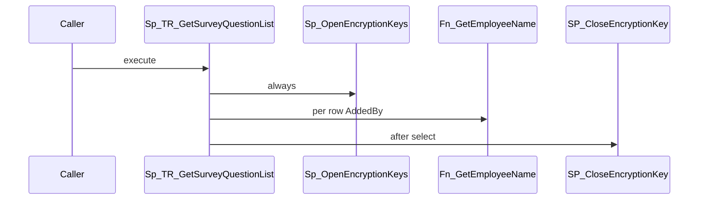
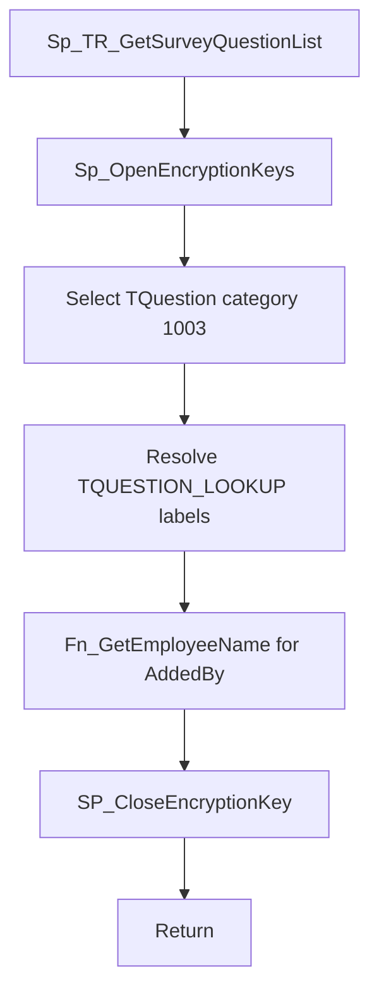

# Sp_TR_GetSurveyQuestionList

## What it does

Loads the questionnaire picker for LMS Training Survey Setup: questions for the root employer where `QuesCategoryCD = 1003`, with category / answer-type / complexity labels from `TQUESTION_LOOKUP` and an `AddedBy` display name via `Fn_GetEmployeeName`. Opens and closes encryption keys around the select (synonyms to core HRMS).

## Parameters

| Name | Direction | What it is for |
|---|---|---|
| `@pREId` | in | Root employer id (`TQuestion.RootEmployerID`) |

## Call sequence

## Callers

No other procedure or function calls this object.

## Nested

| Object | Kind | When | Page |
|---|---|---|---|
| `Sp_OpenEncryptionKeys` | procedure (Training synonym → HRMS) | before select | [Sp_OpenEncryptionKeys](/docs/database/hrms/Sp_OpenEncryptionKeys) |
| `Fn_GetEmployeeName` | function (Training synonym → HRMS) | `AddedBy` column | [Fn_GetEmployeeName](/docs/database/hrms/Fn_GetEmployeeName) |
| `SP_CloseEncryptionKey` | procedure (Training synonym → HRMS) | after select | [SP_CloseEncryptionKey](/docs/database/hrms/SP_CloseEncryptionKey) |

## Steps

1. Script is `HRMS-DATABASE/HRMS-TRAINING/STOREPROCEDURE/Sp_TR_GetSurveyQuestionList.sql`.
2. `SET NOCOUNT ON`.
3. `EXEC dbo.Sp_OpenEncryptionKeys`.
4. `SELECT` from `TQuestion` where `RootEmployerID = @pREId` and `QuesCategoryCD = 1003`.
5. Resolve `QuesCategory` / `AnswerType` / `Complexity` from `TQUESTION_LOOKUP` parents 1000 / 2000 / 3000.
6. Resolve `AddedBy` with `dbo.Fn_GetEmployeeName(T.EditedBy)`.
7. Order by `QuestionID` descending with `ROW_NUMBER()` as `SrNo`.
8. `EXEC dbo.SP_CloseEncryptionKey`.

## Tables

| Table | Read or write |
|---|---|
| `TQuestion` | read |
| `TQUESTION_LOOKUP` | read |

## Flow

