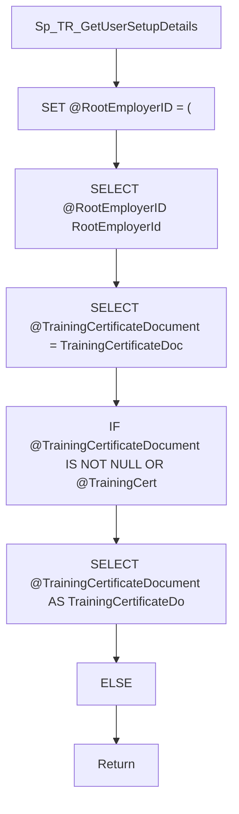

# Sp_TR_GetUserSetupDetails

## What it does

Stored procedure `Sp_TR_GetUserSetupDetails`. Calls no other procedure or function. Touches `temployerdetails`, `TCLAIM_ASSIGNMENT`, `TCLAIM`, `TLOOKUP`, `TEmployeeInfo`, `TORGChart`, `TTrainingSurvey`, `TCustomerSettings`.

## Parameters

| Name | Direction | What it is for |
|---|---|---|
| `@pRoleId` | in | INT |

## Call sequence

Calls no other procedures or functions.

## Callers

No other procedure or function calls this object.

## Nested

Calls no other procedures or functions.

## Steps

1. Script is `HRMS-DATABASE/HRMS-TRAINING/STOREPROCEDURE/Sp_TR_GetUserSetupDetails.sql`.
2. `SET @RootEmployerID = (`
3. `SELECT @RootEmployerID RootEmployerId`
4. `SELECT @TrainingCertificateDocument = TrainingCertificateDocument`
5. `IF @TrainingCertificateDocument IS NOT NULL OR @TrainingCertificateDocument = ''`
6. `SELECT @TrainingCertificateDocument AS TrainingCertificateDocument;`
7. `ELSE`
8. `SELECT @LevelNotifications = WFD.LevelNotifications`
9. `IF @LevelNotifications IS NOT NULL AND @LevelNotifications <> '0'`
10. `SELECT @LevelNotifications AS LevelNotifications;`
11. `ELSE`

## Tables

| Table | Read or write |
|---|---|
| `temployerdetails` | read |
| `TCLAIM_ASSIGNMENT` | read |
| `TCLAIM` | read |
| `TLOOKUP` | read |
| `TEmployeeInfo` | read |
| `TORGChart` | read |
| `TTrainingSurvey` | read |
| `TCustomerSettings` | read |
| `TOrgHierarchyDetails` | read |
| `TEmployerDetails` | read |
| `TWorkflowDetails` | read |
| `TWorkflowManagement` | read |

## Flow

