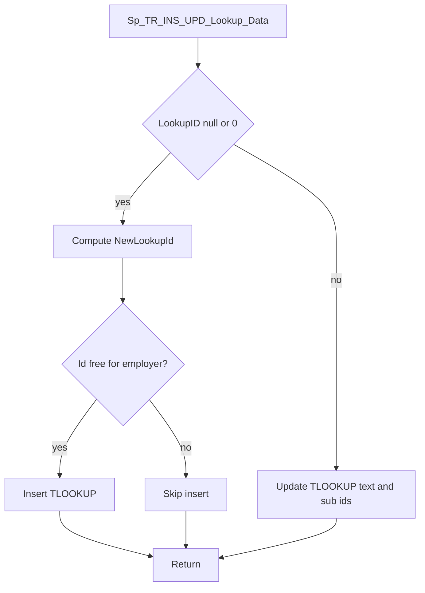

# Sp_TR_INS_UPD_Lookup_Data

## What it does

Inserts a new Training `TLOOKUP` leaf or updates an existing one for `@pEmployerid`. On insert it allocates `Lookup_Id` as one more than the current max id under the same parent and employer (falling back to `@LookupParentId + 1` when none exist), then inserts only if that id is free. On update it rewrites text, `SUB_PARENT_ID`, and `SUB_CHILD_ID`.

## Parameters

| Name | Direction | What it is for |
|---|---|---|
| `@LookupID` | in | Existing lookup id; null/0 means insert |
| `@LookupText` | in | Display text (nvarchar 50) |
| `@LookupParentId` | in | Parent reference-type id |
| `@SubParentId` | in | Optional category / sub-parent link |
| `@SubChildId` | in | Optional sub-category / sub-child link |
| `@pEmployerid` | in | Root employer scope written to `RootEmployerid` |

## Call sequence

Calls no other procedures or functions.

## Callers

No other procedure or function in `HRMS-TRAINING` calls this object. Application caller: Training WebAPI `SaveLookupData`.

## Nested

Calls no other procedures or functions.

## Steps

1. Script is `HRMS-DATABASE/HRMS-TRAINING/STOREPROCEDURE/Sp_TR_INS_UPD_Lookup_Data.sql`.
2. If `@LookupID` is null or 0, compute `@NewLookupId` as `MAX(Lookup_Id)` for that parent and employer plus one (or `@LookupParentId + 1`).
3. If no row already has `@NewLookupId` for the employer, insert into `TLOOKUP` with `isDeleted = 0`.
4. Else update `Lookup_Text`, `SUB_PARENT_ID`, and `SUB_CHILD_ID` for `@LookupID` and `@pEmployerid`.

## Tables

| Table | Read or write |
|---|---|
| `dbo.TLOOKUP` | read and write |

## Flow

