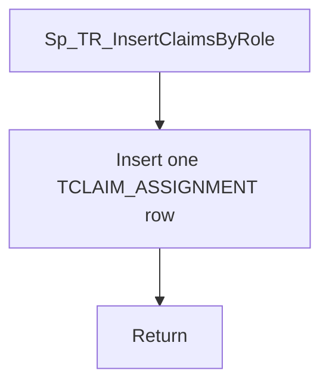

# Sp_TR_InsertClaimsByRole

## What it does

Inserts one `TCLAIM_ASSIGNMENT` row for a claim, role, employer, and optional employee. Training Permission Setup calls it once per checked claim after `Sp_TR_DeleteClaimsByRole` clears the prior set.

## Parameters

| Name | Direction | What it is for |
|---|---|---|
| `@pClaimId` | in | Claim to assign |
| `@pRoleID` | in | Role id for role-mode saves. Default null |
| `@pEmployerId` | in | Employer on the assignment |
| `@pSearchType` | in | Passed by the app (`R` or `E`); not used in the insert body |
| `@pEmployeeId` | in | Employee id for employee-mode saves. Default null |

## Call sequence

Calls no other procedures or functions.

## Callers

No other procedure or function calls this object. App callers: `EmployeeDAL.InsertClaimsBySearchType` → `EmployeeBLL.InsertClaimsBySearchType` → `employeeController.InsertClaimsBySearchType` from [Training Permission Setup](/docs/guides/admin-configuration/training-permission-setup).

## Nested

Calls no other procedures or functions.

## Steps

1. Script is `HRMS-DATABASE/HRMS-TRAINING/STOREPROCEDURE/Sp_TR_InsertClaimsByRole.sql`.
2. Insert into `TCLAIM_ASSIGNMENT` (`ClaimID`, `RoleId`, `Employerid`, `EmployeeId`) the values `@pClaimId`, `@pRoleID`, `@pEmployerId`, `@pEmployeeId`.

## Tables

| Table | Read or write |
|---|---|
| `TCLAIM_ASSIGNMENT` | write |

## Unresolved calls

None.

## Flow

