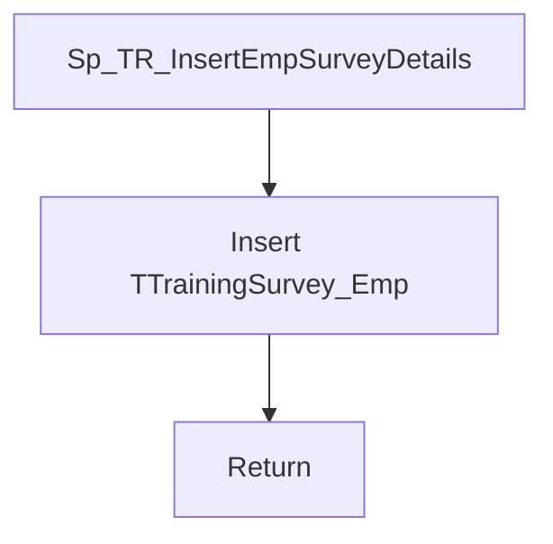

# Sp_TR_InsertEmpSurveyDetails

## What it does

Inserts one employee answer row into `TTrainingSurvey_Emp` for a survey question option (and optional free-text). Called once per selected option inside the BLL submit transaction. No duplicate check.

## Parameters

| Name | Direction | What it is for |
|---|---|---|
| `@pSurveyQuestionID` | in | `TTrainingSurveyQuestions.SurveyQuestionID` |
| `@pQuesOptionID` | in | Selected option id |
| `@pQuesOptionText` | in | Optional descriptive answer text |
| `@pEmployeeId` | in | Answering employee |
| `@pEmployerId` | in | Employer context |

## Call sequence

Calls no other procedures or functions.

## Callers

No other procedure or function calls this object.

## Nested

Calls no other procedures or functions.

## Steps

1. Script is `HRMS-DATABASE/HRMS-TRAINING/STOREPROCEDURE/Sp_TR_InsertEmpSurveyDetails.sql`.
2. `SET NOCOUNT ON`.
3. `INSERT` into `TTrainingSurvey_Emp` with audit columns (`CreatedBy` / `EditedBy` = `@pEmployeeId`, timestamps `GETUTCDATE()`).

## Tables

| Table | Read or write |
|---|---|
| `TTrainingSurvey_Emp` | write |

## Flow

