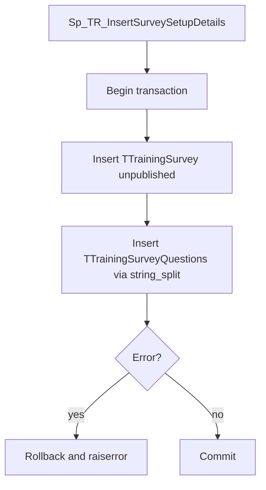

# Sp_TR_InsertSurveySetupDetails

## What it does

Creates a new unpublished training survey for an employer (year, quarter, `OpenTill`) and links the selected question ids from a comma-separated list into `TTrainingSurveyQuestions`. Runs in a transaction; on error rolls back and `RAISERROR`s. Parameter `@pSurveyId` is accepted but not used for update — every call inserts a new header.

## Parameters

| Name | Direction | What it is for |
|---|---|---|
| `@pSurveyId` | in | Accepted by signature; not read in the body |
| `@pEmployerId` | in | Employer for the new survey |
| `@pYear` | in | Survey year |
| `@pQuarter` | in | Quarter string (e.g. `1,2`) |
| `@pQuestionIds` | in | Comma-separated question ids |
| `@pCreatedBy` | in | Creating employee id |
| `@pValidTill` | in | Stored as `OpenTill` |

## Call sequence

Calls no other procedures or functions. Uses built-in `string_split`.

## Callers

No other procedure or function calls this object.

## Nested

Calls no other procedures or functions.

## Steps

1. Script is `HRMS-DATABASE/HRMS-TRAINING/STOREPROCEDURE/Sp_TR_InsertSurveySetupDetails.sql`.
2. `BEGIN TRANSACTION` / `BEGIN TRY`.
3. `INSERT` into `TTrainingSurvey` with `IsPublished = 0`, audit columns, `OpenTill = @pValidTill`.
4. Capture `@TrainingSurveyId` from `SCOPE_IDENTITY()`.
5. `INSERT` into `TTrainingSurveyQuestions` selecting ids from `string_split(@pQuestionIds, ',')`.
6. On catch: roll back if needed and `RAISERROR`.
7. `COMMIT` when `@@TRANCOUNT > 0`.

## Tables

| Table | Read or write |
|---|---|
| `TTrainingSurvey` | write |
| `TTrainingSurveyQuestions` | write |

## Flow

