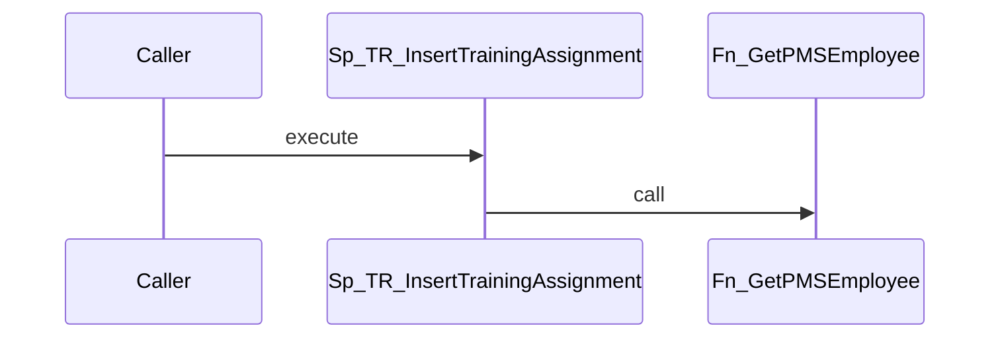
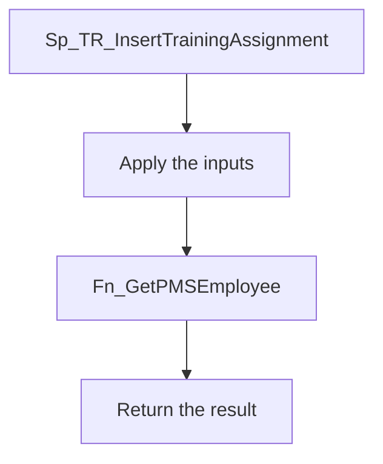

# Sp_TR_InsertTrainingAssignment

## What it does

Assigns a training from the Home upcoming-trainings card. The dashboard call sets the from-dashboard flag. The HRMS database reaches this procedure through a synonym to the Training database.

## Parameters

| Name | Direction | What it is for |
|---|---|---|
| `@pEmployerId` | in | Employer id (`INT`) |
| `@pTrainingID` | in | Training being assigned or removed (`INT`) |
| `@pBusUnitIds` | in | Business units assigned from the card (`VARCHAR(500)`) |
| `@pEmployeeIds` | in | Employees assigned from the card (`VARCHAR(500)`) |
| `@pRoleIds` | in | Roles assigned from the card (`VARCHAR(500)`) |
| `@pIsMandatory` | in | Whether the assignment is mandatory (`BIT`) |
| `@pIsAssignedByAdmin` | in | Whether an administrator assigned it (`BIT`) |
| `@pIsAssignToAll` | in | Whether the assignment covers every employee (`BIT`) |
| `@pCreatedBy` | in | Employee who submitted the assignment (`INT`) |
| `@pReminderStartDate` | in | Input used by this procedure (`DATETIME NULL`) |
| `@pReminderEndDate` | in | Input used by this procedure (`DATETIME NULL`) |
| `@pReminderFrequency` | in | Input used by this procedure (`VARCHAR(50) NULL`) |
| `@pIsPmsTniTraining` | in | Input used by this procedure (`INT NULL`) |
| `@pCoolingPeriodDays` | in | Input used by this procedure (`INT NULL`) |
| `@pRatingTypeId` | in | Input used by this procedure (`INT NULL`) |
| `@pTrainerIds` | in | Input used by this procedure (`VARCHAR(500)`) |
| `@pIsFromDashboard` | in | Set to 1 by the Home assign call (`TinyInt NULL`) |
| `@PMSEmployeeIds` | in | Input used by this procedure (`VARCHAR(500)`) |
| `@ReTrainingEmployeeIds` | in | Input used by this procedure (`VARCHAR(500)`) |

## Call sequence

## Callers

No other procedure or function under STOREPROCEDURE or FUNCTIONS executes this object.

## Nested

| Object | Kind | When | Page |
|---|---|---|---|
| `Fn_GetPMSEmployee` | function | Called while this object runs | [Fn_GetPMSEmployee](/docs/database/hrms-training/Fn_GetPMSEmployee) |

## Steps

In `HRMS-DATABASE/HRMS-TRAINING/STOREPROCEDURE/Sp_TR_InsertTrainingAssignment.sql`:

1. Assigns a training from the Home upcoming-trainings card.
2. The dashboard call sets the from-dashboard flag.
3. The HRMS database reaches this procedure through a synonym to the Training database.

## Tables

| Table | Read or write |
|---|---|
| `TAssignment` | read and write |
| `TEMAIL_NOTIFICATION` | write |
| `E` | write |
| `TEmployerCustomFields` | read |
| `TTraining` | read |
| `TTrainingSession` | read |
| `TOrgChart` | read |
| `TEmployeeInfo` | read |
| `TEMPLOYEE` | read |
| `TUsers` | read |
| `TUserEmployee` | read |
| `TEmployeeTrainingEvaluation` | read |

## Flow

