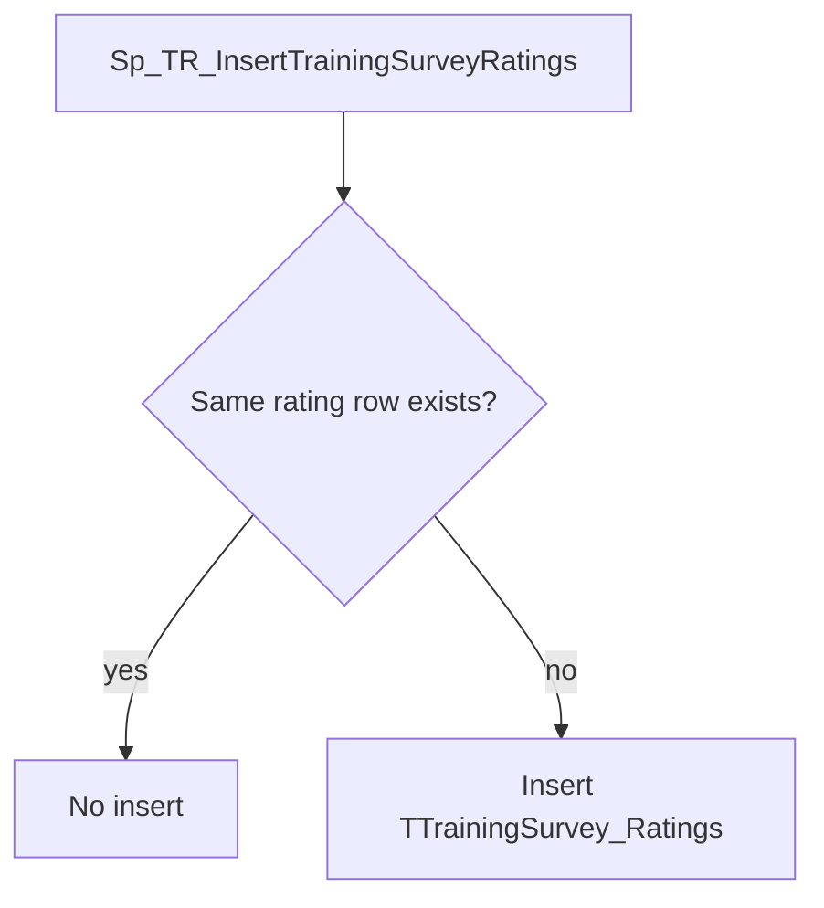

# Sp_TR_InsertTrainingSurveyRatings

## What it does

Inserts a row into `TTrainingSurvey_Ratings` for an employee’s computed survey rating unless an identical `(TrainingSurveyId, EmployeeId, Ratings)` row already exists. Called once after answer inserts in `TrainingSurveyBLL.SubmitTrainingSurvey`.

## Parameters

| Name | Direction | What it is for |
|---|---|---|
| `@pSurveyId` | in | `TrainingSurveyID` |
| `@pEmployeeId` | in | Employee rated |
| `@pRatings` | in | Computed decimal rating |

## Call sequence

Calls no other procedures or functions.

## Callers

No other procedure or function calls this object.

## Nested

Calls no other procedures or functions.

## Steps

1. Script is `HRMS-DATABASE/HRMS-TRAINING/STOREPROCEDURE/Sp_TR_InsertTrainingSurveyRatings.sql`.
2. `IF NOT EXISTS` a matching ratings row for survey, employee, and rating value.
3. Else `INSERT` into `TTrainingSurvey_Ratings` with `CreatedBy = @pEmployeeId` and `CreatedOn = GETUTCDATE()`.

## Tables

| Table | Read or write |
|---|---|
| `TTrainingSurvey_Ratings` | read, write |

## Flow

