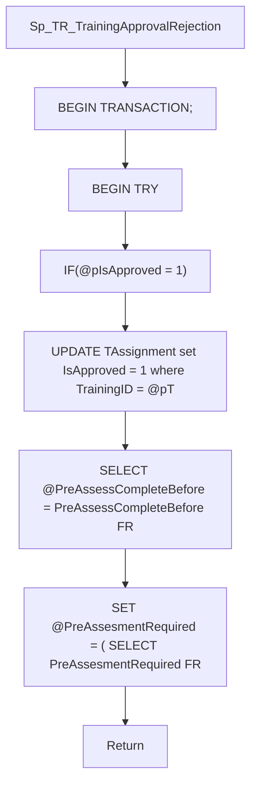

# Sp_TR_TrainingApprovalRejection

## What it does

Stored procedure `Sp_TR_TrainingApprovalRejection`. Calls no other procedure or function. Touches `TAssignment`, `TTraining`, `TTrainingSession`, `TEMAIL_NOTIFICATION`, `STRING_SPLIT`.

## Parameters

| Name | Direction | What it is for |
|---|---|---|
| `@pTrainingId` | in | INT |
| `@pEmployeeId` | in | INT |
| `@pEmployerId` | in | INT |
| `@pIsApproved` | in | BIT |
| `@pComments` | in | varchar(500) |

## Call sequence

Calls no other procedures or functions.

## Callers

No other procedure or function calls this object.

## Nested

Calls no other procedures or functions.

## Steps

1. Script is `HRMS-DATABASE/HRMS-TRAINING/STOREPROCEDURE/Sp_TR_TrainingApprovalRejection.sql`.
2. `BEGIN TRANSACTION;`
3. `BEGIN TRY`
4. `IF(@pIsApproved = 1)`
5. `UPDATE TAssignment set IsApproved = 1 where TrainingID = @pTrainingId`
6. `SELECT @PreAssessCompleteBefore = PreAssessCompleteBefore FROM TTraining WHERE TrainingID = @pTrainingId`
7. `SET @PreAssesmentRequired = ( SELECT PreAssesmentRequired FROM TTraining WHERE TrainingID = @pTrainingId )`
8. `SET @FirstSessionDate = ( SELECT top 1 SessionDate FROM TTrainingSession WHERE TrainingID = @pTrainingId order by SessionDate)`
9. `SET @PreAssessCompleteBeforeDate = DATEADD(DD, -@PreAssessCompleteBefore, @FirstSessionDate)`
10. `IF( @PreAssesmentRequired = 1 AND CAST(GETDATE() AS DATE) <= @PreAssessCompleteBeforeDate )`
11. `INSERT INTO [dbo].[TEMAIL_NOTIFICATION]`
12. `ELSE`
13. `set @EmpWaitingNum = (`
14. `set @AssignmentIds = (`
15. `IF (LEN(@AssignmentIds) > 0)`
16. `UPDATE TAssignment SET WaitingNum = WaitingNum -1 where AssignmentID IN (SELECT value FROM STRING_SPLIT(@AssignmentIds, ','));`
17. `UPDATE TAssignment set IsApproved = 2 , Comments = @pComments`
18. `IF EXISTS(Select 1 from TAssignment where TrainingID = @pTrainingId and IsInWaitingList = 1)`
19. `UPDATE TAssignment set IsInWaitingList = 0 where AssignmentID =`

## Tables

| Table | Read or write |
|---|---|
| `TAssignment` | read and write |
| `TTraining` | read |
| `TTrainingSession` | read |
| `TEMAIL_NOTIFICATION` | write |
| `STRING_SPLIT` | read |

## Flow

