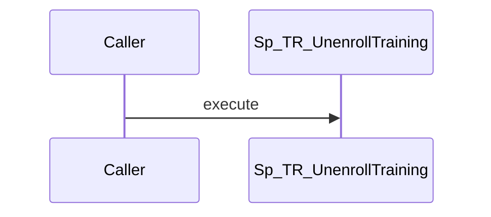
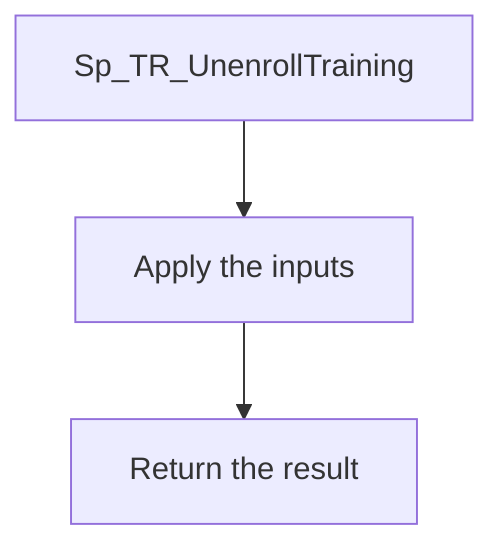

# Sp_TR_UnenrollTraining

## What it does

Removes one employee from a training when they unassign it on the Home card, and returns the seats still available. The HRMS database reaches this procedure through a synonym to the Training database.

## Parameters

| Name | Direction | What it is for |
|---|---|---|
| `@pTrainingID` | in | Training being assigned or removed (`INT`) |
| `@pEmployeeId` | in | Employee id (`INT`) |
| `@pEmployerId` | in | Employer id (`INT`) |

## Call sequence

## Callers

No other procedure or function under STOREPROCEDURE or FUNCTIONS executes this object.

## Nested

This object does not execute another procedure or user-defined function.

## Steps

In `HRMS-DATABASE/HRMS-TRAINING/STOREPROCEDURE/Sp_TR_UnenrollTraining.sql`:

1. Removes one employee from a training when they unassign it on the Home card, and returns the seats still available.
2. The HRMS database reaches this procedure through a synonym to the Training database.

## Tables

| Table | Read or write |
|---|---|
| `TASSIGNMENT` | read and write |
| `TTraining` | read |

## Flow

