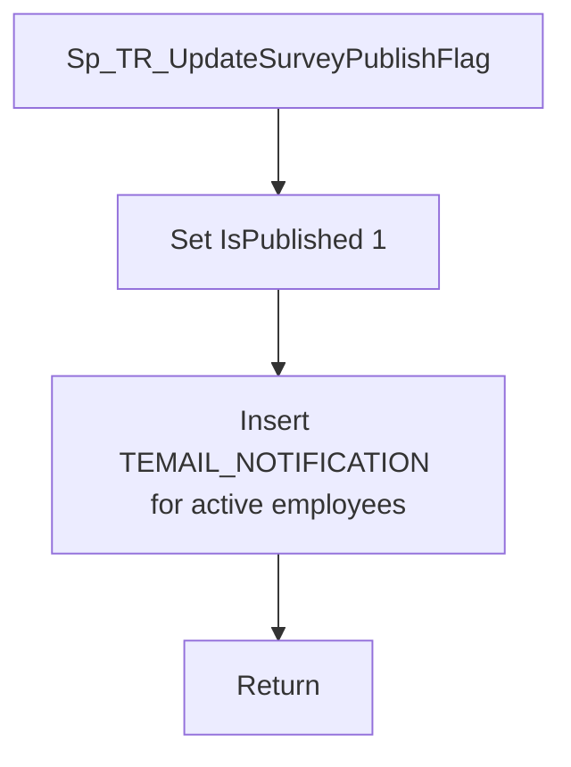

# Sp_TR_UpdateSurveyPublishFlag

## What it does

Marks a training survey published (`IsPublished = 1`) and queues one `TEMAIL_NOTIFICATION` row per active employee in that survey’s employer, with `ModulePageName = 'TR-TrainingTeamSurvey'` and `NotificationType = 'NOTIFICATIONONLY'`. Does not clear other published surveys; the SPA enforces “one active published” before calling.

## Parameters

| Name | Direction | What it is for |
|---|---|---|
| `@pSurveyId` | in | `TTrainingSurvey.TrainingSurveyID` to publish |
| `@pUpdatedBy` | in | Employee id stamped on `EditedBy` |

## Call sequence

Calls no other procedures or functions.

## Callers

No other procedure or function calls this object.

## Nested

Calls no other procedures or functions.

## Steps

1. Script is `HRMS-DATABASE/HRMS-TRAINING/STOREPROCEDURE/Sp_TR_UpdateSurveyPublishFlag.sql`.
2. `UPDATE TTrainingSurvey` set `IsPublished = 1`, `EditedBy`, `EditedOn = GETUTCDATE()` for `@pSurveyId`.
3. `INSERT INTO TEMAIL_NOTIFICATION` selecting distinct active employees (`TEMPLOYEE.IsActive = 'Y'`) joined to `TEmployeeInfo` for the survey’s `EmployerId`.

## Tables

| Table | Read or write |
|---|---|
| `TTrainingSurvey` | read, write |
| `TEMAIL_NOTIFICATION` | write |
| `TEmployeeInfo` | read |
| `TEMPLOYEE` | read |

## Flow

