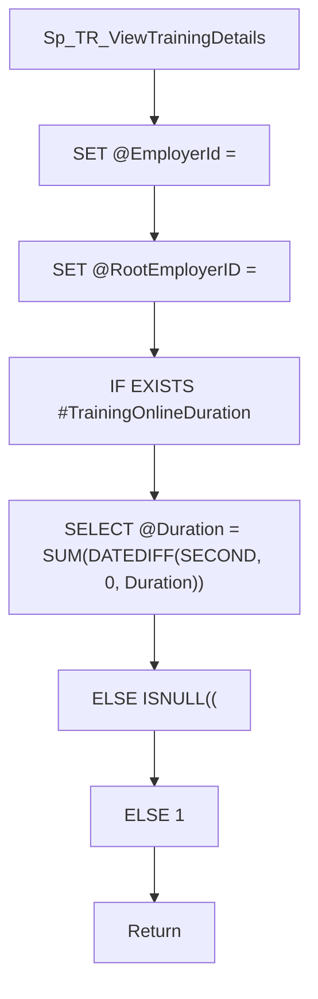

# Sp_TR_ViewTrainingDetails

## What it does

Stored procedure `Sp_TR_ViewTrainingDetails`. Calls no other procedure or function. Touches `TEMPLOYEE`, `TEmployerDetails`, `TTraining`, `TTrainingDocuments`, `TDocuments`, `TLOOKUP`, `TAssignment`, `TFeedback_Emp`.

## Parameters

| Name | Direction | What it is for |
|---|---|---|
| `@pTrainingId` | in | INT |
| `@pEmployeeId` | in | INT |

## Call sequence

Calls no other procedures or functions.

## Callers

No other procedure or function calls this object.

## Nested

Calls no other procedures or functions.

## Steps

1. Script is `HRMS-DATABASE/HRMS-TRAINING/STOREPROCEDURE/Sp_TR_ViewTrainingDetails.sql`.
2. `SET @EmployerId =`
3. `SET @RootEmployerID =`
4. `IF EXISTS #TrainingOnlineDuration`
5. `SELECT @Duration = SUM(DATEDIFF(SECOND, 0, Duration))`
6. `ELSE ISNULL((`
7. `ELSE 1`
8. `ELSE 0`
9. `ELSE`

## Tables

| Table | Read or write |
|---|---|
| `TEMPLOYEE` | read |
| `TEmployerDetails` | read |
| `TTraining` | read |
| `TTrainingDocuments` | read |
| `TDocuments` | read |
| `TLOOKUP` | read |
| `TAssignment` | read |
| `TFeedback_Emp` | read |
| `TTrainers` | read |
| `TAttendance` | read |
| `TFEEDBACK_EMP` | read |
| `TAssessment` | read |
| `TFeedback` | read |
| `TQuiz` | read |
| `TTrainingSession` | read |
| `TOnlineTrainingCompletion` | read |

## Flow

