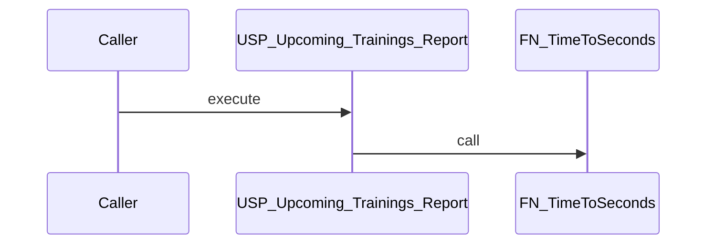
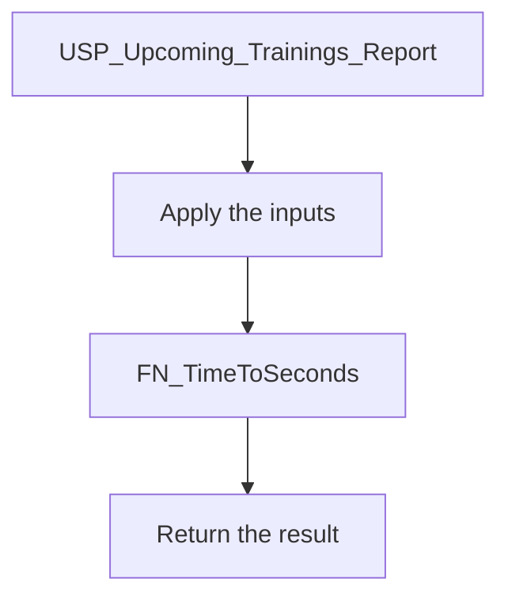

# USP_Upcoming_Trainings_Report

## What it does

Returns upcoming trainings the employee can see on the Home card, including whether they can assign or unassign a seat. The HRMS database reaches this procedure through a synonym to the Training database.

## Parameters

| Name | Direction | What it is for |
|---|---|---|
| `@EmployeeID` | in | Employee the Home screen is loading or acting for (`INT`) |
| `@EmployerID` | in | Employer that owns the data (`INT`) |

## Call sequence

## Callers

No other procedure or function under STOREPROCEDURE or FUNCTIONS executes this object.

## Nested

| Object | Kind | When | Page |
|---|---|---|---|
| `FN_TimeToSeconds` | function | Called while this object runs | [FN_TimeToSeconds](/docs/database/hrms/FN_TimeToSeconds) |

## Steps

In `HRMS-DATABASE/HRMS-TRAINING/STOREPROCEDURE/USP_Upcoming_Trainings_Report.sql`:

1. Returns upcoming trainings the employee can see on the Home card, including whether they can assign or unassign a seat.
2. The HRMS database reaches this procedure through a synonym to the Training database.

## Tables

| Table | Read or write |
|---|---|
| `OT` | write |
| `TEmployerDetails` | read |
| `TTraining` | read |
| `TAssignment` | read |
| `TTrainingSession` | read |
| `TOnlineTrainingCompletion` | read |
| `TTrainers` | read |

## Flow

