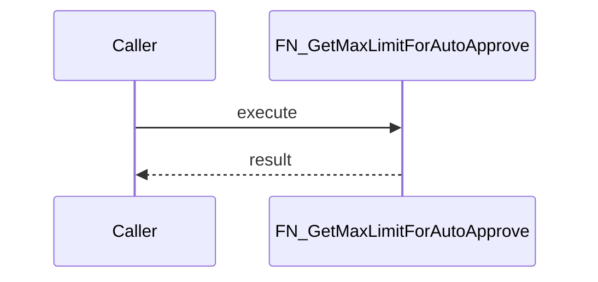
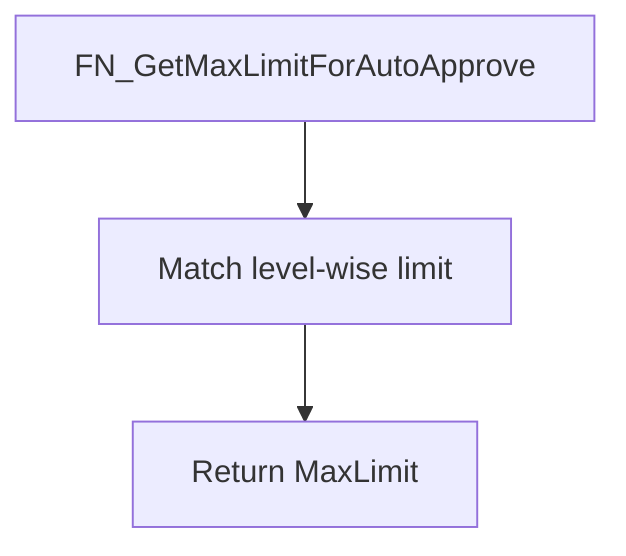

# FN_GetMaxLimitForAutoApprove

## What it does

Scalar function returning the max limit for an expense line from `TLevelWiseExpenseDetails`, matching employee grade/BU/designation/location/role and expense-type lookup context. Used by `Sp_TnE_GetExpenseReportData` when no history limit row applies.

## Parameters

| Name | Direction | What it is for |
|---|---|---|
| `@pEmployerID` | in | Employer |
| `@pExpenseTypeID` | in | Expense type lookup id |
| `@pLookup_Parent_ID` | in | Optional parent lookup |
| `@pLookup_ID` | in | Detail lookup id |
| `@pEmployeeID` | in | Employee for attribute match |
| `@Expenseid` / `@SequenceID` | in | Expense line identity |

## Call sequence

## Callers

| Caller | Page |
|---|---|
| `Sp_TnE_GetExpenseReportData` | [Sp_TnE_GetExpenseReportData](/docs/database/hrms-travelnexpense/Sp_TnE_GetExpenseReportData) |

## Nested

Calls no other procedures. Reads `TEmployeeInfo`, `TUsers`/`TUserEmployee` for role inside an outer apply.

## Steps

1. Select top matching `TLevelWiseExpenseDetails.MaxLimit` for employer/type/lookup with employee attributes (`NOLOCK`).

## Tables

| Table | Read or write |
|---|---|
| `TLevelWiseExpenseDetails` | read |
| `TEmployeeInfo` | read |
| `TUsers` / `TUserEmployee` | read |

## Unresolved calls

None.

## Flow

