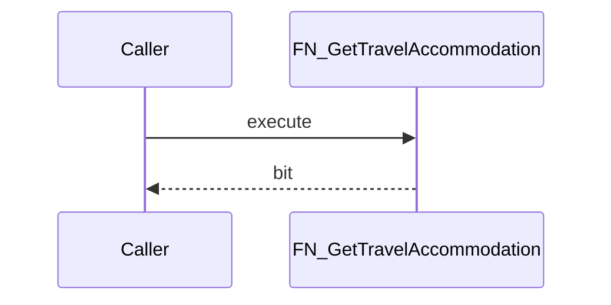
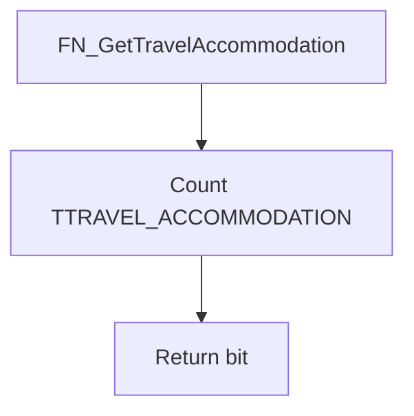

# FN_GetTravelAccommodation

## What it does

Scalar bit function that returns `1` when the travel request has at least one `TTRAVEL_ACCOMMODATION` row, otherwise `0`. Used by `Sp_TnE_GetTravelReportData` to filter on accommodation requested.

## Parameters

| Name | Direction | What it is for |
|---|---|---|
| `@TravelRequestId` | in | Travel request to test |

## Call sequence

## Callers

| Caller | Page |
|---|---|
| `Sp_TnE_GetTravelReportData` | [Sp_TnE_GetTravelReportData](/docs/database/hrms-travelnexpense/Sp_TnE_GetTravelReportData) |

## Nested

Calls no other procedures or functions.

## Steps

1. Script `HRMS-DATABASE/HRMS_TRAVELNEXPENSE/FUNCTIONS/FN_GetTravelAccommodation.sql`.
2. Count rows in `TTRAVEL_ACCOMMODATION` for `@TravelRequestId`.
3. Return `0` when count is zero, else `1`.

## Tables

| Table | Read or write |
|---|---|
| `TTRAVEL_ACCOMMODATION` | read |

## Unresolved calls

None.

## Flow

