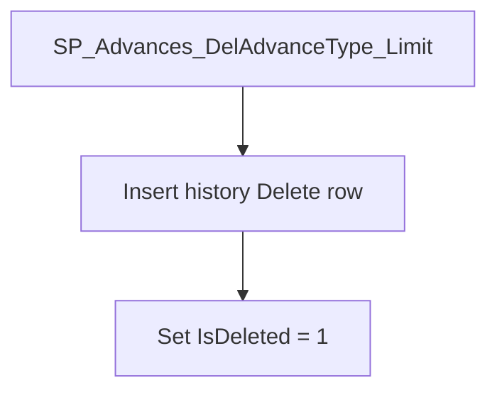

# SP_Advances_DelAdvanceType_Limit

## What it does

Soft-deletes an advance type limit. Copies the current row into history with action `Delete`, then sets `IsDeleted = 1` on the live row.

## Parameters

| Name | Direction | What it is for |
|---|---|---|
| `@AdvanceTypeLimitId` | in | Limit row to delete |
| `@UpdatedBy` | in | Actor recorded on history and last-updated |

## Call sequence

Calls no other procedures or functions.

## Callers

No other procedure or function in `HRMS_TRAVELNEXPENSE` calls this object. The Core API Advance Module DAL calls it from `DeleteAdvanceTypeLimit`.

## Nested

Calls no other procedures or functions.

## Steps

1. Insert the current `tAdvanceType_Limit` row into `tAdvanceType_Limit_History` with `Action = 'Delete'`, history actor `@UpdatedBy`, and UTC timestamps.
2. Update `tAdvanceType_Limit` set `IsDeleted = 1`, `LastUpdatedBy`, and `LastUpdatedOn` for `@AdvanceTypeLimitId`.

## Tables

| Table | Read or write |
|---|---|
| `dbo.tAdvanceType_Limit` | read/write |
| `dbo.tAdvanceType_Limit_History` | write |

## Flow

