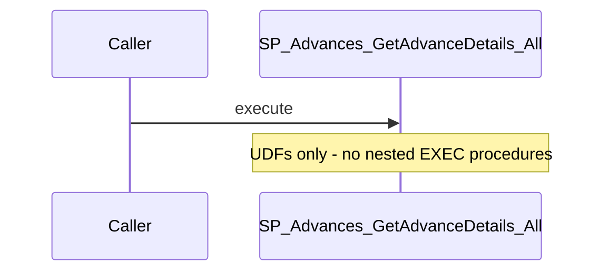
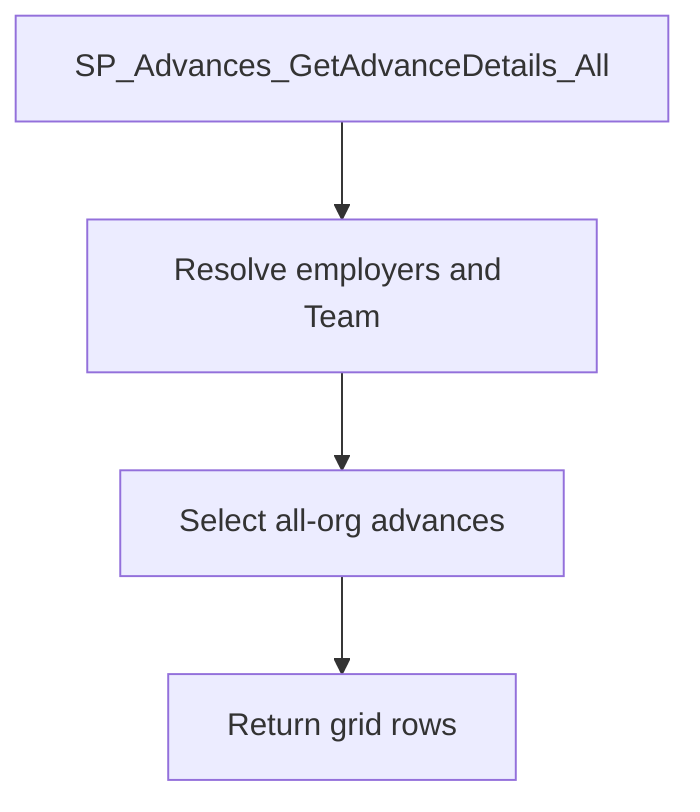

# SP_Advances_GetAdvanceDetails_All

## What it does

Returns advance request grid rows for the **All Request** tab across a CSV employer scope. Builds an employee `#Team` for the selected employers (active, or active+inactive when `@isInactive = 1`), with optional employee-id and business-unit filters, then projects the same header/status/pending/paid shape as the other list procedures.

## Parameters

| Name | Direction | What it is for |
|---|---|---|
| `@EmployeeId` | in | Login employee id (cross-reporting flags read from this row) |
| `@EmployerId` | in | Employer id or CSV |
| `@AdvanceRequestDetailId` | in | Optional single request detail id |
| `@pStatusId` | in | CSV of status lookup ids |
| `@StartDate` | in | Created-on window start |
| `@EndDate` | in | Created-on window end |
| `@employeeIds` | in | Optional CSV of employee ids |
| `@BusinessUnit` | in | Optional CSV of business-unit ids |
| `@isInactive` | in | `1` include inactive employees |

## Call sequence

## Callers

| Caller | Page |
|---|---|
| `advanceModuleDAL.GetAdvanceRequestsAll` | Advance Requests guide |

## Nested

| Object | Kind | When | Page |
|---|---|---|---|
| — | — | No nested `EXEC` procedures | — |

## Steps

1. Resolve active/inactive employee filter from `@isInactive`.
2. Split employers into `@TEmployers` and populate `#Team` for matching org employees (optional BU / employee filters).
3. Select advance headers for those employees with status/date filters and project grid columns.

## Tables

| Table | Read or write |
|---|---|
| `tAdvances_AdvanceRequestByEmployee` | read |
| `tAdvances_AdvanceRequestStatus` | read |
| `tAdvances_AdvanceByEmployeeDetails` / `tAdvances_AdvancePaidDetails` | read |
| `TEmployee` / `TEmployeeInfo` / `TEmployerDetails` / `TOrgHierarchyDetails` | read |
| `TLOOKUP` / `TRequestWorkflows` / `tCostCenter` / `TProject` / `TCountry` | read |

## Unresolved calls

None beyond inline advance UDFs.

## Flow

