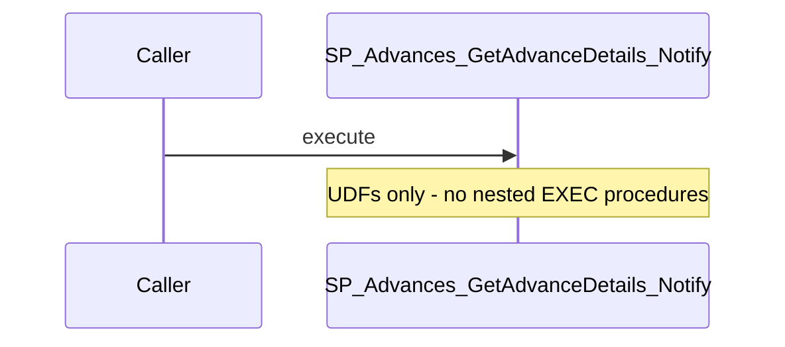
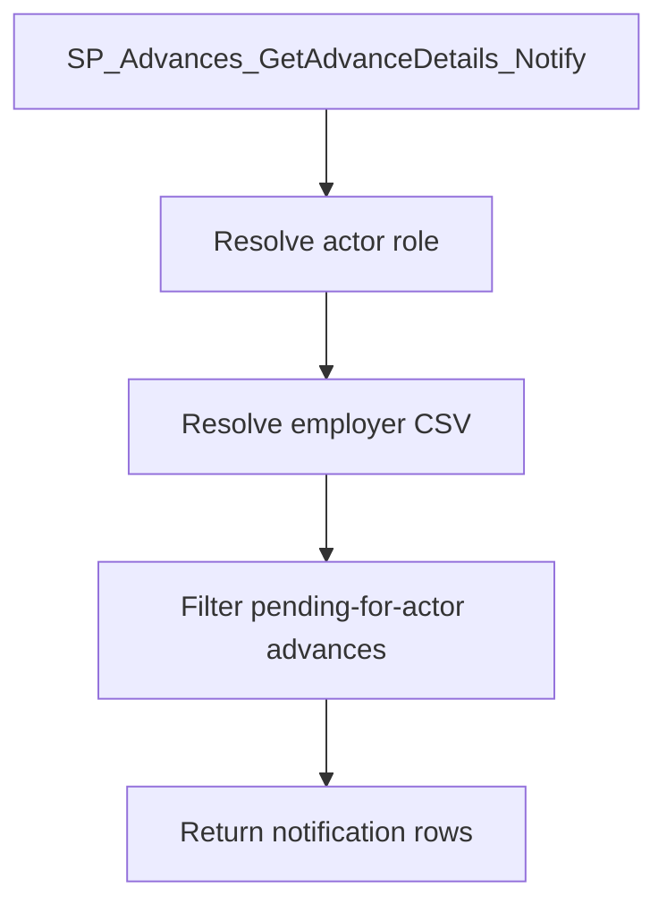

# SP_Advances_GetAdvanceDetails_Notify

## What it does

Returns advance request grid rows for the **Notification** tab: requests in the CSV employer scope where the login employee is currently pending in `TRequestWorkflows` / `UFN_Advances_GetPendingApprovalInfo` (pending-with employee id list contains `@EmployeeId`). Supports optional inactive employees.

## Parameters

| Name | Direction | What it is for |
|---|---|---|
| `@EmployeeId` | in | Approver / login employee id |
| `@EmployerId` | in | Employer id or CSV |
| `@AdvanceRequestDetailId` | in | Optional single request detail id |
| `@isInactive` | in | `1` include inactive request owners |

## Call sequence

## Callers

| Caller | Page |
|---|---|
| `advanceModuleDAL.GetAdvanceRequestsNotify` / `GetAdvanceRequestsNotifyWithFilters` | Advance Requests guide |

## Nested

| Object | Kind | When | Page |
|---|---|---|---|
| — | — | No nested `EXEC` procedures | — |

## Steps

1. Resolve actor role name from `TUsers` / `TRoles` / `TUserEmployee`.
2. Split `@EmployerId` into `@TEmployers`.
3. Select advance headers where the actor appears in pending-with employee ids for the employer scope.
4. Project status, pending, paid, notes/docs columns (same shape as other list SPs).

## Tables

| Table | Read or write |
|---|---|
| `tAdvances_AdvanceRequestByEmployee` | read |
| `tAdvances_AdvanceRequestStatus` | read |
| `TRequestWorkflows` | read |
| `TUsers` / `TRoles` / `TUserEmployee` | read |
| `TEmployee` / `TEmployeeInfo` / `TEmployerDetails` / `TOrgHierarchyDetails` | read |
| `tAdvances_AdvanceByEmployeeDetails` / `tAdvances_AdvancePaidDetails` / `TLOOKUP` / `TCountry` | read |

## Unresolved calls

None beyond inline advance UDFs. Node DAL may attempt `@EmployerIds`; this procedure declares `@EmployerId` only.

## Flow

