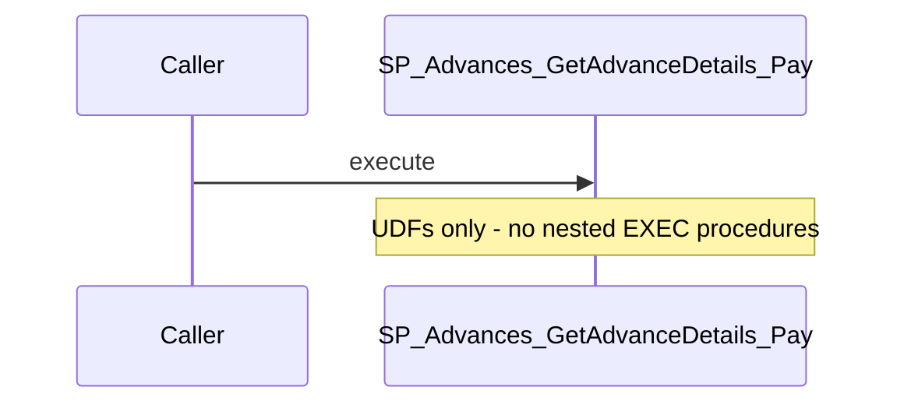
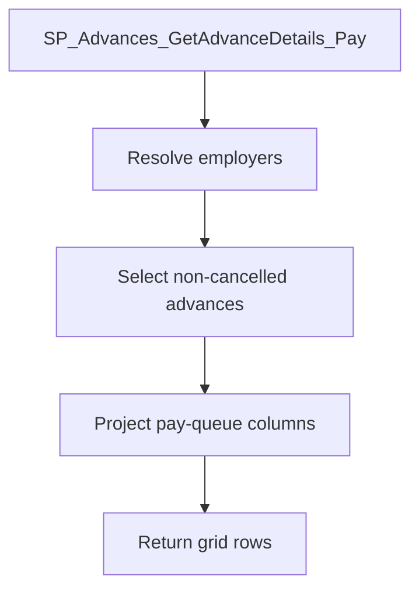

# SP_Advances_GetAdvanceDetails_Pay

## What it does

Returns advance request grid rows for the **Pay Advance** (accountant) tab within a CSV employer scope. Excludes cancelled statuses. Supports status CSV, date window, employee ids, business units, and inactive employees. Projects limit totals and raw requested amount in addition to the shared list columns.

## Parameters

| Name | Direction | What it is for |
|---|---|---|
| `@EmployeeId` | in | Login / accountant employee id |
| `@EmployerId` | in | Employer id or CSV |
| `@AdvanceRequestDetailId` | in | Optional single request detail id |
| `@pStatusId` | in | CSV of status lookup ids |
| `@StartDate` | in | Created-on window start |
| `@EndDate` | in | Created-on window end |
| `@employeeIds` | in | Optional CSV of employee ids |
| `@BusinessUnit` | in | Optional CSV of business-unit ids |
| `@isInactive` | in | `1` include inactive employees |

## Call sequence

## Callers

| Caller | Page |
|---|---|
| `advanceModuleDAL.GetAdvanceRequestsPay` | Advance Requests guide |

## Nested

| Object | Kind | When | Page |
|---|---|---|---|
| — | — | No nested `EXEC` procedures | — |

## Steps

1. Read cross-reporting flags for the login employee and split employers into `@TEmployers`.
2. Select advance headers in scope, excluding cancelled lookup text, applying status/date/employee/BU/active filters.
3. Project accountant-oriented columns (limit sum, raw amount, pending, paid).

## Tables

| Table | Read or write |
|---|---|
| `tAdvances_AdvanceRequestByEmployee` | read |
| `tAdvances_AdvanceRequestStatus` | read |
| `tAdvances_AdvanceByEmployeeDetails` / `tAdvances_AdvancePaidDetails` | read |
| `TEmployee` / `TEmployeeInfo` / `TEmployerDetails` / `TOrgHierarchyDetails` | read |
| `TLOOKUP` / `TRequestWorkflows` / `tCostCenter` / `TProject` / `TCountry` | read |

## Unresolved calls

None beyond inline advance UDFs.

## Flow

