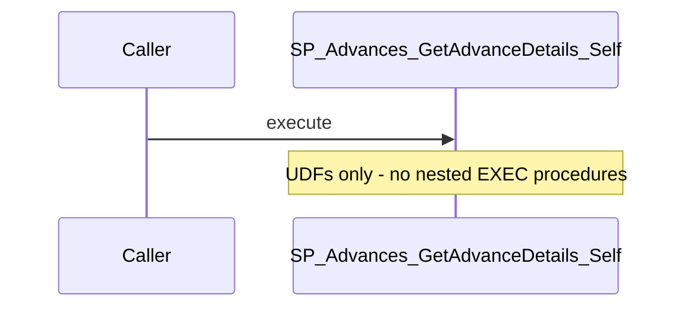
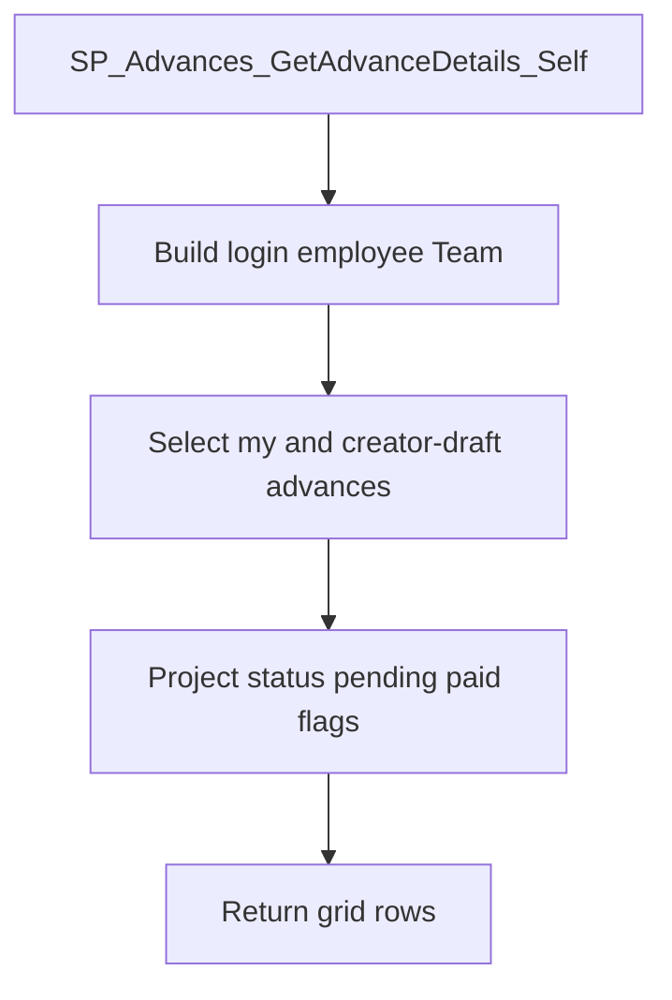

# SP_Advances_GetAdvanceDetails_Self

## What it does

Returns advance request grid rows for the **My Request** tab: requests belonging to the login employee (hiding drafts someone else created for them), plus Save-As-Draft rows the login user created for other employees. Optional status CSV and created-on date window. When `@AdvanceRequestDetailId` is set, also returns document and paid-detail recordsets for that id.

## Parameters

| Name | Direction | What it is for |
|---|---|---|
| `@EmployeeId` | in | Login employee id |
| `@EmployerId` | in | Employer id (typed `INT` in SQL; used in paid-detail lookup / status expand) |
| `@AdvanceRequestDetailId` | in | Optional single request detail id |
| `@pStatusId` | in | CSV of status lookup ids |
| `@StartDate` | in | Created-on window start |
| `@EndDate` | in | Created-on window end |

## Call sequence

## Callers

| Caller | Page |
|---|---|
| `advanceModuleDAL.GetAdvanceRequestsSelf` | Advance Requests guide |

## Nested

| Object | Kind | When | Page |
|---|---|---|---|
| — | — | No nested `EXEC` procedures | — |

Inline UDFs include `UFN_Advances_GetPendingApprovalInfo`, `USP_Advances_FN_Get_CurrencyAmount`, `FN_Advances_GetExpandedStatusIDs`, `UFN_Advances_GetPendingAccountantName`, `Fn_GetEmployeeName`.

## Steps

1. Build `#Team` as the login employee (org name, employment number, business unit).
2. Select from `tAdvances_AdvanceRequestByEmployee` for self-owned rows, creator drafts for others, or the optional detail id.
3. Project status labels, pending-with via `UFN_Advances_GetPendingApprovalInfo`, paid totals, notes/docs counts, and optional travel custom id.
4. When a detail id is supplied, return document and paid-detail secondary result sets.

## Tables

| Table | Read or write |
|---|---|
| `tAdvances_AdvanceRequestByEmployee` | read |
| `tAdvances_AdvanceRequestStatus` | read |
| `tAdvances_AdvanceByEmployeeDetails` | read |
| `tAdvances_AdvancePaidDetails` | read |
| `tAdvances_AdvanceDocuments` / `TDocuments` | read |
| `TADVANCE_COMMENT` | read |
| `TRequestWorkflows` / `TWorkflowDetails` | read |
| `TLOOKUP` / `TEmployee` / `TEmployeeInfo` / `TEmployerDetails` / `TOrgHierarchyDetails` | read |
| `tCostCenter` / `TProject` / `TCountry` / `TTRAVEL_REQUEST` | read |

## Unresolved calls

None beyond the inline UDFs listed above.

## Flow

