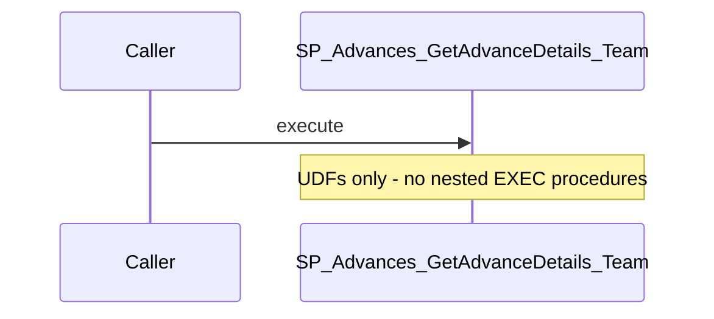
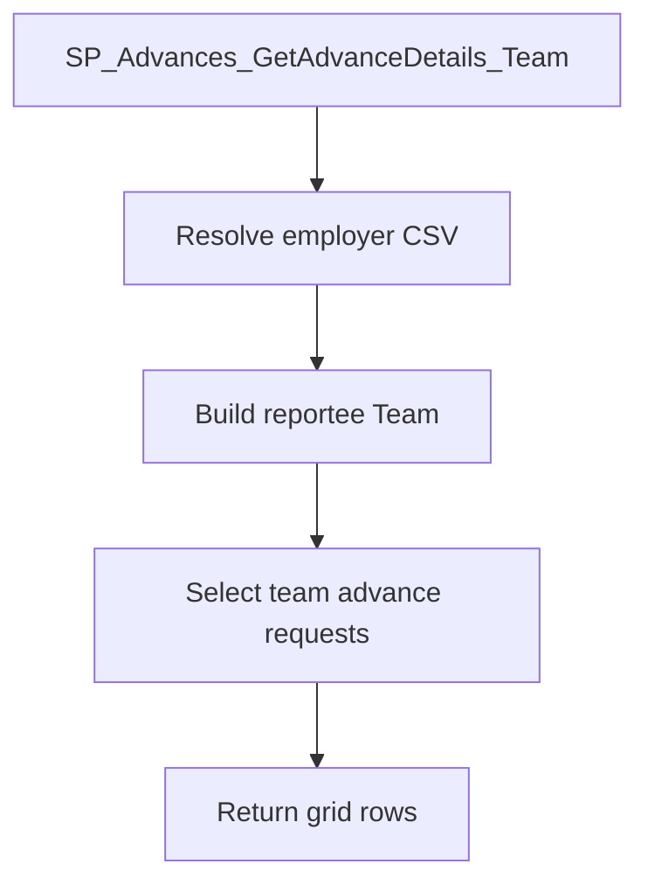

# SP_Advances_GetAdvanceDetails_Team

## What it does

Returns advance request grid rows for the **Team Request** tab: active reportees of the login employee (functional manager and/or org-chart `TORGChart.reportsto`) within a CSV employer scope, excluding the login user from the team set. Supports status, date, and optional employee-id filters.

## Parameters

| Name | Direction | What it is for |
|---|---|---|
| `@EmployeeId` | in | Manager / login employee id |
| `@EmployerId` | in | Employer id or CSV |
| `@AdvanceRequestDetailId` | in | Optional single request detail id |
| `@pStatusId` | in | CSV of status lookup ids |
| `@StartDate` | in | Created-on window start |
| `@EndDate` | in | Created-on window end |
| `@employeeIds` | in | Optional CSV of reportee employee ids |

## Call sequence

## Callers

| Caller | Page |
|---|---|
| `advanceModuleDAL.GetAdvanceRequestsTeam` | Advance Requests guide |

## Nested

| Object | Kind | When | Page |
|---|---|---|---|
| — | — | No nested `EXEC` procedures | — |

## Steps

1. Split `@EmployerId` into `@TEmployers`.
2. Insert active reportees into `#Team` (functional manager + org chart), then delete the login employee.
3. Select advance headers for team members with status/date/employee filters and project pending/paid/status columns.

## Tables

| Table | Read or write |
|---|---|
| `tAdvances_AdvanceRequestByEmployee` | read |
| `tAdvances_AdvanceRequestStatus` | read |
| `tAdvances_AdvanceByEmployeeDetails` / `tAdvances_AdvancePaidDetails` | read |
| `TEmployee` / `TEmployeeInfo` / `TEmployerDetails` / `TORGChart` / `TOrgHierarchyDetails` | read |
| `TLOOKUP` / `TRequestWorkflows` / `tCostCenter` / `TProject` / `TCountry` | read |

## Unresolved calls

None beyond inline advance UDFs (`UFN_Advances_GetPendingApprovalInfo`, currency/status helpers).

## Flow

