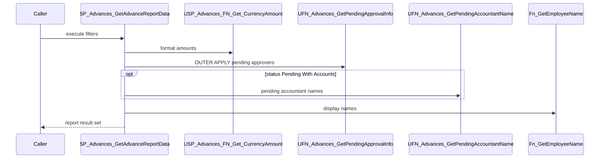
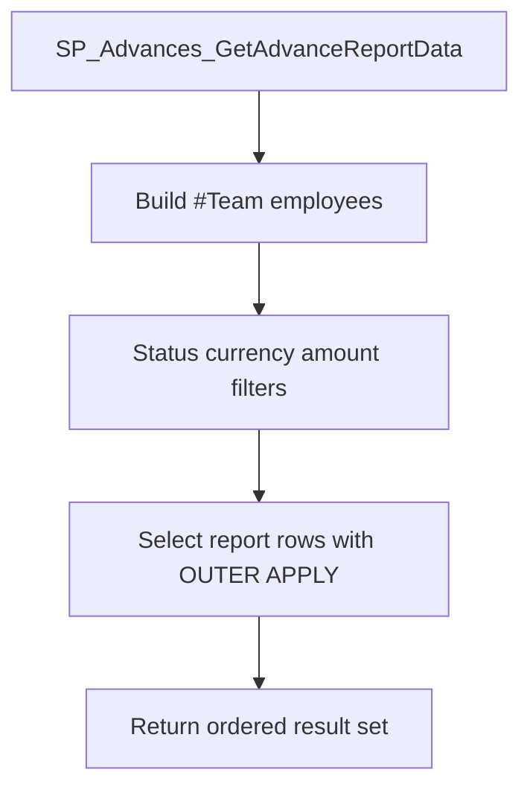

# SP_Advances_GetAdvanceReportData

## What it does

Returns filtered advance-request report rows for an employer (or cross-reporting root). Builds a `#Team` employee set, expands status lookup ids (including In-Process / Rejected child levels and “all”), then selects distinct request rows with type/limit/estimated amounts, travel linkage, status labels, pending-with (approver or accountant), payment summary, document/note counts, and L1–L5 approver columns.

## Parameters

| Name | Direction | What it is for |
|---|---|---|
| `@EmployeeId` | in | Actor employee; used for cross-reporting / root employer resolution |
| `@EmployerId` | in | Employer filter and lookup scope |
| `@AdvanceRequestDetailId` | in | Optional single request; also resolves request employee when set |
| `@pStatusId` | in | CSV of status lookup ids; `-1` expands to all advance statuses |
| `@AdvanceTypeId` | in | CSV of advance type ids; `-1` / null means all |
| `@pFromDate` | in | Optional created-on lower bound |
| `@pToDate` | in | Optional created-on upper bound |
| `@pReqCurrencyCodeId` | in | Optional currency filter; null includes all `TCountry` ids |
| `@pReqestedAmount` | in | Optional estimated-amount compare value |
| `@pReqOperator` | in | Amount operator (`=`, `>`, `>=`, `<`, `<=`, `<>`) |
| `@pCostCenter` | in | Optional cost center id |
| `@pProjectId` | in | Optional project id |
| `@pShouldHaveTravelRequest` | in | When 1, only rows with a travel request |
| `@isInactive` | in | `0` → active employees only (`Y`); else `Y,N` |

## Call sequence

## Callers

| Caller | Page |
|---|---|
| `advanceModuleDAL.getAdvanceReportData` via `POST /advanceModule/getAdvanceReportData` | [Advances Report](/docs/guides/advances/report) |

No other procedure in `HRMS_TRAVELNEXPENSE` calls this object.

## Nested

| Object | Kind | When | Page |
|---|---|---|---|
| `USP_Advances_FN_Get_CurrencyAmount` | function | Amount display / raw columns | [USP_Advances_FN_Get_CurrencyAmount](/docs/database/hrms-travelnexpense/USP_Advances_FN_Get_CurrencyAmount) |
| `UFN_Advances_GetPendingApprovalInfo` | function | OUTER APPLY for pending approver fields | [UFN_Advances_GetPendingApprovalInfo](/docs/database/hrms-travelnexpense/UFN_Advances_GetPendingApprovalInfo) |
| `UFN_Advances_GetPendingAccountantName` | function | When status maps to Pending With Accounts (1206) | [UFN_Advances_GetPendingAccountantName](/docs/database/hrms-travelnexpense/UFN_Advances_GetPendingAccountantName) |
| `Fn_GetEmployeeName` | function (synonym) | RequestedBy / CreatedBy / UpdatedBy / employee / L1–L5 names | [Fn_GetEmployeeName](/docs/database/hrms/Fn_GetEmployeeName) |

## Steps

1. Optionally resolve `@Request_EmployeeID` from `tAdvances_AdvanceRequestByEmployee` when `@AdvanceRequestDetailId` is set.
2. Create `#Team`; resolve cross-reporting from `TEmployee` / `TEmployerDetails`; insert employer employees (active or active+inactive per `@isInactive`).
3. Build `@ReqCurrencyCodes` and amount min/max/`NOT IN` bounds from currency and operator parameters.
4. Expand `#StatusIDs` from CSV; add child In-Process (1186–1190) / Rejected (1218–1222) ids; if `-1`, load the full advance status set from `tLookUp`.
5. CTE latest `tAdvances_AdvancePaidDetails` per request; main SELECT joins request, type details, status, travel, cost center, project, currency, workflow OUTER APPLY, and L1–L5 OUTER APPLY from `tAdvanceRequest_AdvanceTypeStatus`.
6. Filter by team or detail id, status, type, dates, currency, amount, cost center, project, travel flag; order by `AdvanceRequestDetailId` DESC.

## Tables

| Table | Read or write |
|---|---|
| `tAdvances_AdvanceRequestByEmployee` | read |
| `tAdvances_AdvanceByEmployeeDetails` | read |
| `tAdvances_AdvanceRequestStatus` | read |
| `tAdvances_AdvancePaidDetails` | read |
| `tAdvanceRequest_AdvanceTypeStatus` | read |
| `tAdvanceTypeDetails` | read |
| `TEmployee` / `TEmployeeInfo` / `TEmployerDetails` / `TOrgHierarchyDetails` | read |
| `tLookUp` / `TLOOKUP` | read |
| `TTRAVEL_REQUEST` / `TTRAVEL_SCHEDULE` | read |
| `tCostCenter` / `TProject` / `TCountry` | read |
| `TREQUESTWORKFLOWS` / `TWorkflowDetails` / `tworkflowmanagement` | read (via nested UFN) |
| `TADVANCE_COMMENT` / `tAdvances_AdvanceDocuments` | read (counts) |

## Unresolved calls

None beyond the nested functions listed above.

## Flow

