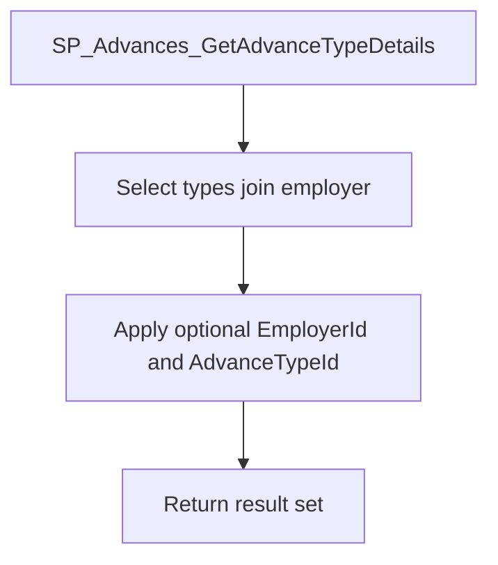

# SP_Advances_GetAdvanceTypeDetails

## What it does

Returns advance type rows for an employer, optionally filtered to one `AdvanceTypeId`. Each row includes employer name, active/inactive status text, and whether attachment is mandatory.

## Parameters

| Name | Direction | What it is for |
|---|---|---|
| `@EmployerId` | in | Employer filter; null returns all employers |
| `@AdvanceTypeId` | in | Optional single type filter |

## Call sequence

Calls no other procedures or functions.

## Callers

No other procedure or function in `HRMS_TRAVELNEXPENSE` calls this object. The Core API Advance Module DAL calls it from `GetAdvanceTypes` / `GetAdvanceTypeDetails`.

## Nested

Calls no other procedures or functions.

## Steps

1. Select from `tAdvanceTypeDetails` joined to `TEmployerDetails`.
2. Map `IsActive` to `Active` / `InActive` and `isAttachmentMandatory` to `Yes` / `No`.
3. Filter by `@EmployerId` and `@AdvanceTypeId` when those parameters are not null.

## Tables

| Table | Read or write |
|---|---|
| `dbo.tAdvanceTypeDetails` | read |
| `dbo.TEmployerDetails` | read |

## Flow

