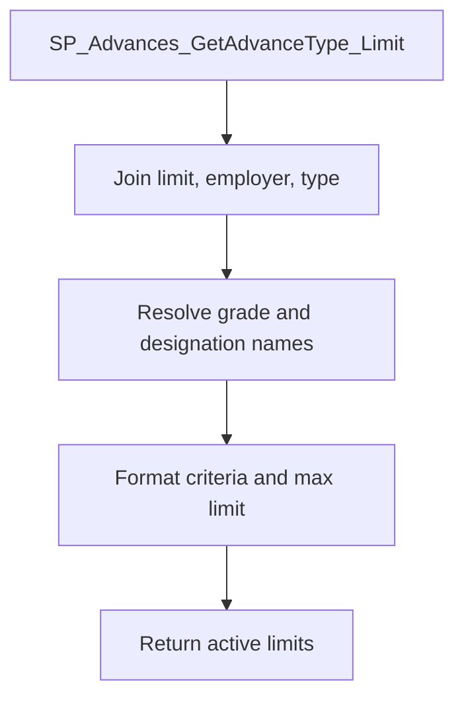

# SP_Advances_GetAdvanceType_Limit

## What it does

Lists active, non-deleted advance type limits for an employer (or one limit id). Resolves grade and designation names and formats limit criteria and max limit for the UI grid.

## Parameters

| Name | Direction | What it is for |
|---|---|---|
| `@EmployerId` | in | Employer filter; null returns all employers |
| `@AdvanceTypeLimitId` | in | Optional single limit filter |

## Call sequence

Calls no other procedures or functions.

## Callers

No other procedure or function in `HRMS_TRAVELNEXPENSE` calls this object. The Core API Advance Module DAL calls it from `GetAdvanceTypeLimits` / `GetAdvanceTypeLimitDetails`.

## Nested

Calls no other procedures or functions.

## Steps

1. Select from `tAdvanceType_Limit` joined to `TEmployerDetails` and active `tAdvanceTypeDetails`.
2. Map `SetLimitBasedOn` (`G`/`D`/other) to Grade / Designation / None.
3. Resolve grade and designation display names from `TGrade` and `TTitle` via scalar subqueries.
4. Map `LimitCriteria` (`CTC`/`F`/`N`) and format `MaxLimit` with a percent suffix for CTC.
5. Keep rows where the limit is active and not deleted, filtered by the optional parameters.

## Tables

| Table | Read or write |
|---|---|
| `dbo.tAdvanceType_Limit` | read |
| `dbo.TEmployerDetails` | read |
| `dbo.tAdvanceTypeDetails` | read |
| `dbo.TGrade` | read |
| `dbo.TTitle` | read |

## Flow

