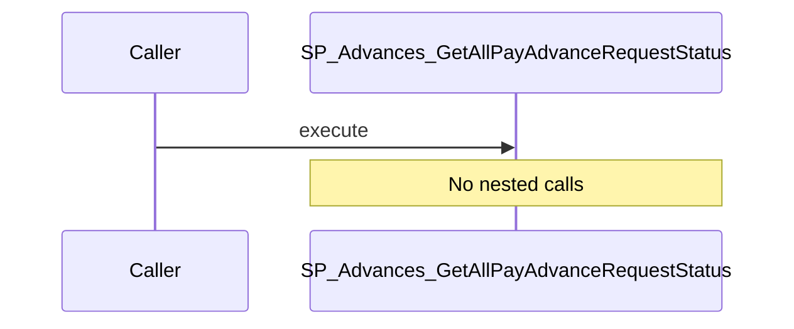
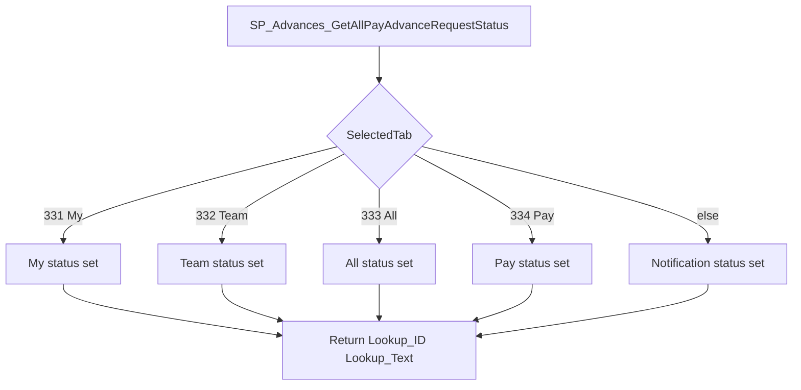

# SP_Advances_GetAllPayAdvanceRequestStatus

## What it does

Returns status filter options from `TLOOKUP` for the Advance Requests list, segregated by `@SelectedTab` (My `331`, Team `332`, All `333`, Pay `334`, else Notification). Renames some labels for the UI (for example Employee Submitted → Submitted; consolidates in-process / rejected level ids in the CASE expression for display).

## Parameters

| Name | Direction | What it is for |
|---|---|---|
| `@EmployerId` | in | Employer id for lookup rows |
| `@SelectedTab` | in | Tab id (`331`–`334` or other for notification) |

## Call sequence

## Callers

| Caller | Page |
|---|---|
| `advanceModuleDAL.GetAllPayAdvanceRequestStatus` | Advance Requests guide |

## Nested

| Object | Kind | When | Page |
|---|---|---|---|
| — | — | None | — |

## Steps

1. Branch on `@SelectedTab`.
2. Select the allowed `Lookup_ID` set for that tab from `TLOOKUP` for `@EmployerId`.
3. Apply display-label CASE overrides and return the list.

## Tables

| Table | Read or write |
|---|---|
| `TLOOKUP` | read |

## Unresolved calls

None.

## Flow

