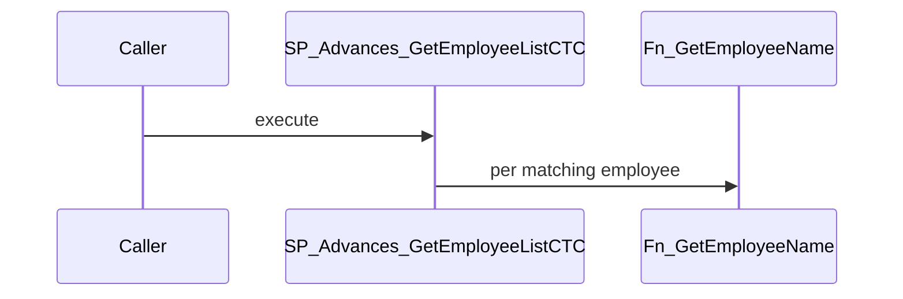
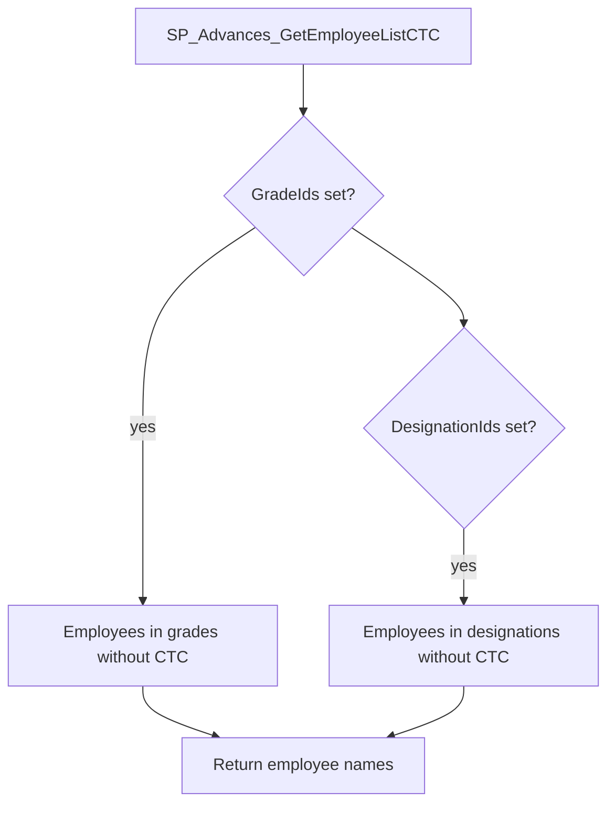

# SP_Advances_GetEmployeeListCTC

## What it does

Returns display names of active employees who have no `TEmpSalary` row for the selected grades or designations. Advance Setup uses this before saving a CTC-based limit so the administrator can see who still needs CTC.

## Parameters

| Name | Direction | What it is for |
|---|---|---|
| `@EmployerId` | in | Employer filter |
| `@GradeIds` | in | Comma-separated grade ids; when non-empty, runs the grade branch |
| `@DesignationIds` | in | Comma-separated designation ids; when non-empty, runs the designation branch |

## Call sequence

## Callers

No other procedure or function in `HRMS_TRAVELNEXPENSE` calls this object. The Core API Advance Module DAL calls it from `GetCTCSetup` (note: DAL currently binds `@Entity_Flag` / `@Entity_Value`, which do not match these parameter names).

## Nested

| Object | Kind | When | Page |
|---|---|---|---|
| `Fn_GetEmployeeName` | function (synonym → HRMS) | each selected employee name | [Fn_GetEmployeeName](/docs/database/hrms/Fn_GetEmployeeName) |

## Steps

1. When `@GradeIds` is not empty, select `Fn_GetEmployeeName` for active employees whose grade is in the split list, employer matches, and `TEmpSalary` is missing.
2. When `@DesignationIds` is not empty, run the same pattern filtered by designation ids.

## Tables

| Table | Read or write |
|---|---|
| `dbo.TEmployee` | read |
| `dbo.TEmployeeInfo` | read |
| `dbo.TEmpSalary` | read |

## Flow

