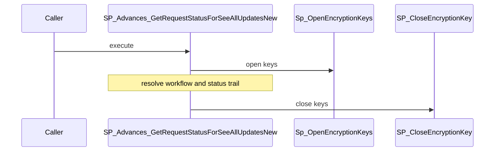
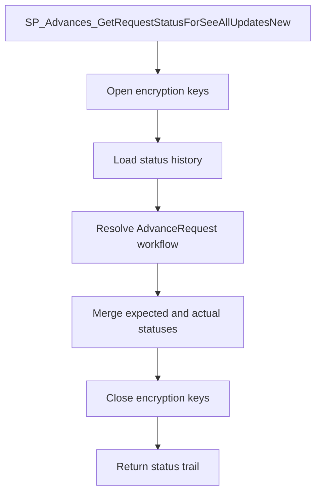

# SP_Advances_GetRequestStatusForSeeAllUpdatesNew

## What it does

Builds the **See All Updates** status trail for one advance request: opens encryption keys, loads current/history rows from `tAdvances_AdvanceRequestStatus`, resolves the AdvanceRequest workflow tree, fills expected status steps from lookups and manager/accountant helpers, merges actual timestamps/actors, then closes encryption keys and returns the ordered status detail set.

## Parameters

| Name | Direction | What it is for |
|---|---|---|
| `@AdvanceRequestDetailId` | in | Advance request detail id |
| `@EmployerId` | in | Employer id (caller context) |

## Call sequence

## Callers

| Caller | Page |
|---|---|
| `advanceModuleDAL._getAdvanceRequestHistory` via `GetAdvanceRequestHistoryUpdates` | Advance Requests guide |

## Nested

| Object | Kind | When | Page |
|---|---|---|---|
| `Sp_OpenEncryptionKeys` | procedure | start of proc | [Sp_OpenEncryptionKeys](/docs/database/hrms/Sp_OpenEncryptionKeys) |
| `SP_CloseEncryptionKey` | procedure | end of proc | [SP_CloseEncryptionKey](/docs/database/hrms/SP_CloseEncryptionKey) |

Also uses UDFs such as `UFN_CM_GetWorkflowTreeXmlDetailsByPageTitle`, `UFN_Advances_ReturnNextManagers`, `UFN_TNE_Advances_GetPendingAccountantName` (not separate nested `EXEC` pages).

## Steps

1. `EXEC Sp_OpenEncryptionKeys`.
2. Load current status history for the detail id; resolve request employee and employer.
3. Resolve workflow id for page title `AdvanceRequest` and max routing levels.
4. Build expected status steps from lookups / workflow / manager helpers; merge with actual `tAdvances_AdvanceRequestStatus` and `TRequestWorkflows` pending-with.
5. Return ordered status detail rows; `EXEC SP_CloseEncryptionKey`.

## Tables

| Table | Read or write |
|---|---|
| `tAdvances_AdvanceRequestByEmployee` | read |
| `tAdvances_AdvanceRequestStatus` | read |
| `TWorkflowDetails` / `tworkflowmanagement` | read |
| `TLOOKUP` / `TRequestWorkflows` / `TEMAIL_NOTIFICATION` | read |

## Unresolved calls

Inline UDFs listed under Nested are not documented as separate database pages in this pass.

## Flow

