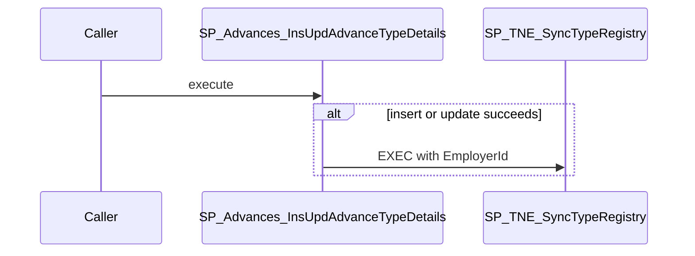
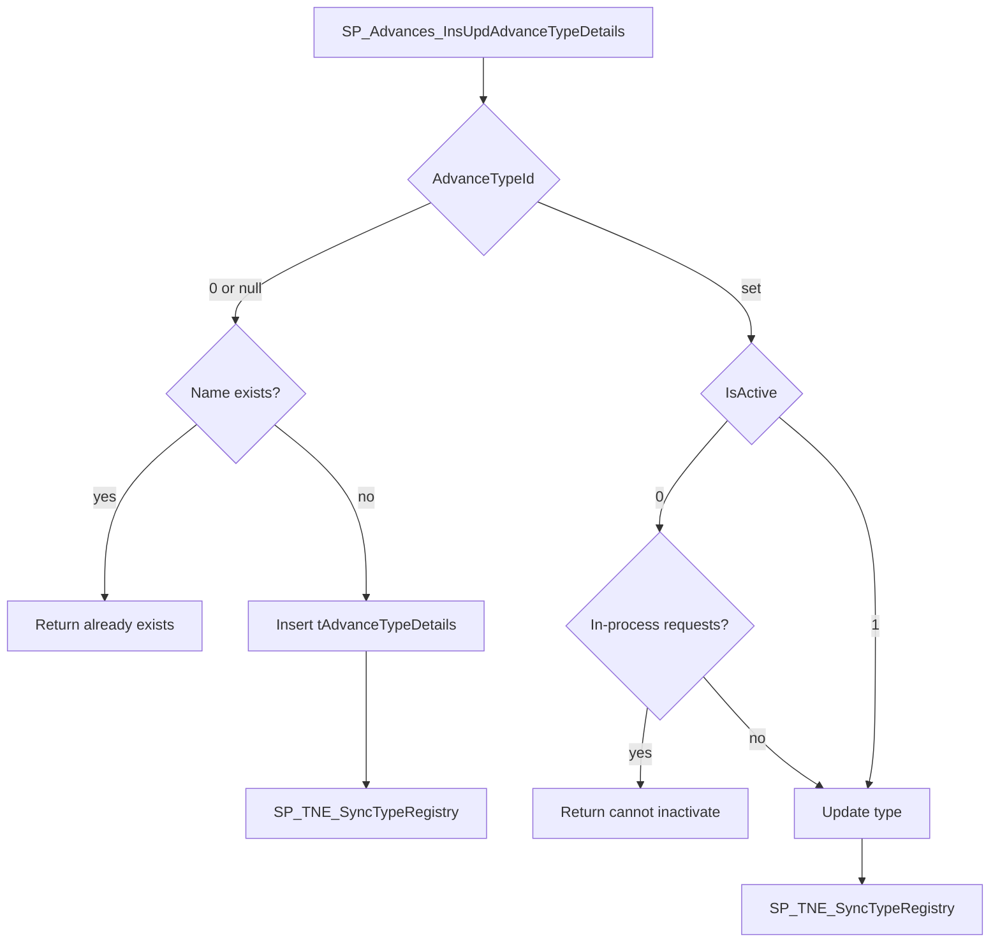

# SP_Advances_InsUpdAdvanceTypeDetails

## What it does

Inserts a new advance type or updates an existing one for an employer. Rejects duplicate names. Blocks inactivation when advance requests for that type are still in process. After a successful insert or update, syncs the Policy Engine type registry for the employer.

## Parameters

| Name | Direction | What it is for |
|---|---|---|
| `@EmployerId` | in | Employer that owns the type |
| `@AdvanceType` | in | Type display name |
| `@IsActive` | in | Active flag |
| `@CreatedBy` | in | Actor employee id (create and last-updated) |
| `@AdvanceTypeId` | in | Null/0 for insert; existing id for update |
| `@isAttachmentMandatory` | in | Optional attachment-required flag |

## Call sequence

## Callers

No other procedure or function in `HRMS_TRAVELNEXPENSE` calls this object. The Core API Advance Module DAL calls it from `_upsertAdvanceType` (insert and update).

## Nested

| Object | Kind | When | Page |
|---|---|---|---|
| `SP_TNE_SyncTypeRegistry` | procedure | after successful insert or update | [SP_TNE_SyncTypeRegistry](/docs/database/hrms-travelnexpense/SP_TNE_SyncTypeRegistry) |

## Steps

1. When `@AdvanceTypeId` is null/0, insert into `tAdvanceTypeDetails` if the name is unique for the employer; otherwise return `Record already exists` and exit.
2. On successful insert, execute `SP_TNE_SyncTypeRegistry` for `@EmployerId`.
3. When updating with `@IsActive = 0`, block if latest request status for that type is in the in-process set (1175, 1176, 1185–1190, 1206); return an error message.
4. When updating, reject duplicate names on other rows, then update `tAdvanceTypeDetails` and sync the registry again.
5. When reactivating (`@IsActive = 1`), apply the same duplicate check, update the row, and sync the registry.

## Tables

| Table | Read or write |
|---|---|
| `dbo.tAdvanceTypeDetails` | read/write |
| `dbo.tAdvances_AdvanceByEmployeeDetails` | read |
| `dbo.tAdvances_AdvanceRequestStatus` | read |

## Flow

