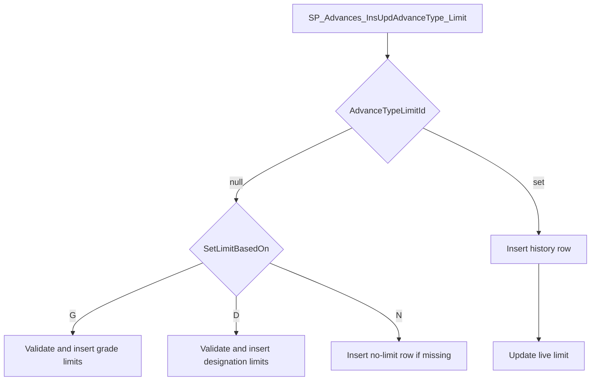

# SP_Advances_InsUpdAdvanceType_Limit

## What it does

Inserts or updates advance type limit rows for grade, designation, or no-limit criteria. On insert it expands comma-separated grade or designation ids into one row each, rejects combinations that already exist, and supports a no-limit (`N`) path. On update it writes history for the edited row, then updates that row (and related paths for grade/designation changes in the remainder of the script).

## Parameters

| Name | Direction | What it is for |
|---|---|---|
| `@AdvanceTypeLimitId` | in | Null/0 for insert; existing id for update |
| `@AdvanceTypeId` | in | Advance type the limit belongs to |
| `@EmployerId` | in | Employer |
| `@SetLimitBasedOn` | in | `G` grade, `D` designation, `N` no limit |
| `@GradeIds` | in | Comma-separated grade ids when based on grade |
| `@DesignationIds` | in | Comma-separated designation ids when based on designation |
| `@LimitCriteria` | in | `CTC`, `F`, or `N` |
| `@MaxLimit` | in | Limit value |
| `@CurrencyId` | in | Currency for flat amounts |
| `@CreatedBy` | in | Actor employee id |

## Call sequence

Calls no other procedures or functions.

## Callers

No other procedure or function in `HRMS_TRAVELNEXPENSE` calls this object. The Core API Advance Module DAL calls it from `_upsertAdvanceTypeLimit`.

## Nested

Calls no other procedures or functions.

## Steps

1. When inserting (`@AdvanceTypeLimitId` null/0), build temp `#Grade_DesignationDetails` from `string_split` of grade or designation ids.
2. For grade-based insert, validate against existing active limits; insert new `tAdvanceType_Limit` rows when clear, otherwise return a duplicate-combination message.
3. For designation-based insert, run the same validate-then-insert pattern against designations.
4. For no-limit (`N` or empty grade and designation lists), insert one no-limit row when none exists for that type/employer.
5. When `@AdvanceTypeLimitId` is set, insert the current row into `tAdvanceType_Limit_History` with action `Update`, then update the live limit according to the new based-on / criteria values (remainder of script in `SP_Advances_InsUpdAdvanceType_Limit.sql`).

## Tables

| Table | Read or write |
|---|---|
| `dbo.tAdvanceType_Limit` | read/write |
| `dbo.tAdvanceType_Limit_History` | write |
| `dbo.tAdvanceTypeDetails` | read |
| `dbo.TGrade` | read |
| `dbo.TTitle` | read |

## Flow

