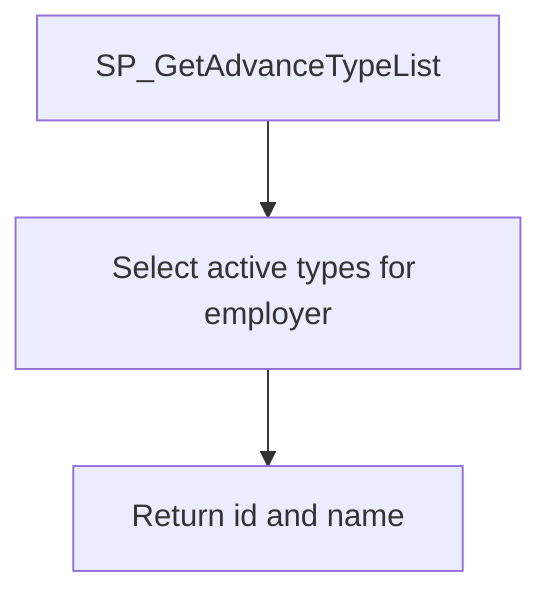

# SP_GetAdvanceTypeList

## What it does

Returns the active advance types for one employer as a simple id/name list for dropdowns.

## Parameters

| Name | Direction | What it is for |
|---|---|---|
| `@EmployerId` | in | Employer whose active types are listed |

## Call sequence

Calls no other procedures or functions.

## Callers

No other procedure or function in `HRMS_TRAVELNEXPENSE` calls this object. The Core API Advance Module DAL calls it from `GetAdvanceTypesOfEmployer`.

## Nested

Calls no other procedures or functions.

## Steps

1. Select `AdvanceTypeId` and `AdvanceType` from `tAdvanceTypeDetails`.
2. Keep rows where `EmployerId = @EmployerId` and `IsActive = 1`.

## Tables

| Table | Read or write |
|---|---|
| `dbo.tAdvanceTypeDetails` | read |

## Flow

