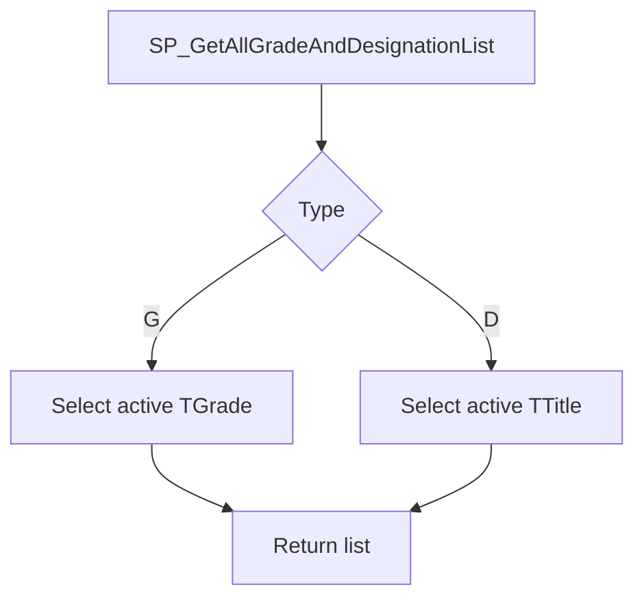

# SP_GetAllGradeAndDesignationList

## What it does

Returns either active grades or active designations for an employer, depending on `@Type`. Used by Advance Setup when building limit forms.

## Parameters

| Name | Direction | What it is for |
|---|---|---|
| `@Employerid` | in | Employer whose masters are listed |
| `@Type` | in | `G` for grades, `D` for designations |

## Call sequence

Calls no other procedures or functions.

## Callers

No other procedure or function in `HRMS_TRAVELNEXPENSE` calls this object. The Core API Advance Module DAL calls it from `GetGrades` (`G`) and `GetDesignations` (`D`).

## Nested

Calls no other procedures or functions.

## Steps

1. When `@Type = 'G'`, select active grades from `TGrade` for the employer.
2. When `@Type = 'D'`, select active titles from `TTitle` for the employer (`IsActive = 'Y'`).

## Tables

| Table | Read or write |
|---|---|
| `dbo.TGrade` | read |
| `dbo.TTitle` | read |

## Flow

