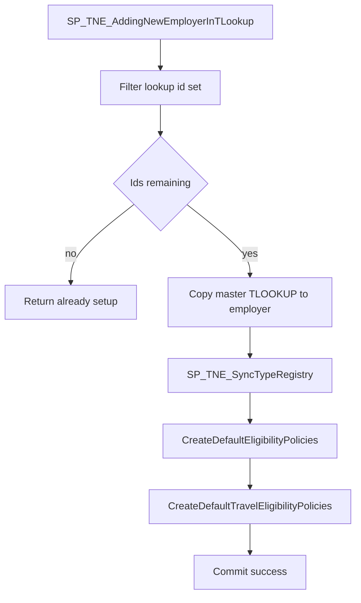

# SP_TNE_AddingNewEmployerInTLookup

## What it does

Stored procedure `SP_TNE_AddingNewEmployerInTLookup`. Copies selected master lookup branches (`Employerid = 0`) onto a target employer, skipping travel/payment root ids that already exist for that employer, then syncs the type registry and creates default expense and travel eligibility policies when appropriate. Returns a status message.

## Parameters

| Name | Direction | What it is for |
|---|---|---|
| `@Employerid` | in | INT — target employer |
| `@LookupId` | in | VARCHAR(MAX) — comma-separated root lookup ids to copy |
| `@CreatedBy` | in | INT |
| `@CreatedOn` | in | DATETIME |

## Call sequence

1. [`SP_TNE_SyncTypeRegistry`](/docs/database/hrms-travelnexpense/SP_TNE_SyncTypeRegistry)
2. [`SP_TNE_CreateDefaultEligibilityPolicies`](/docs/database/hrms-travelnexpense/SP_TNE_CreateDefaultEligibilityPolicies)
3. [`SP_TNE_CreateDefaultTravelEligibilityPolicies`](/docs/database/hrms-travelnexpense/SP_TNE_CreateDefaultTravelEligibilityPolicies)

## Callers

No other procedure or function in this database calls this object. Application caller: Travel WebAPI `AddingNewEmployerInTLookup` via `TravelDAL.AddingNewEmployerInTLookup`.

| Caller | Page |
|---|---|
| (application only) | No page yet |

## Nested

| Object | Page |
|---|---|
| `SP_TNE_SyncTypeRegistry` | [`/docs/database/hrms-travelnexpense/SP_TNE_SyncTypeRegistry`](/docs/database/hrms-travelnexpense/SP_TNE_SyncTypeRegistry) |
| `SP_TNE_CreateDefaultEligibilityPolicies` | [`/docs/database/hrms-travelnexpense/SP_TNE_CreateDefaultEligibilityPolicies`](/docs/database/hrms-travelnexpense/SP_TNE_CreateDefaultEligibilityPolicies) |
| `SP_TNE_CreateDefaultTravelEligibilityPolicies` | [`/docs/database/hrms-travelnexpense/SP_TNE_CreateDefaultTravelEligibilityPolicies`](/docs/database/hrms-travelnexpense/SP_TNE_CreateDefaultTravelEligibilityPolicies) |

## Steps

1. Script is `HRMS-DATABASE/HRMS_TRAVELNEXPENSE/STOREPROCEDURE/SP_TNE_AddingNewEmployerInTLookup.sql`.
2. Begin transaction; split `@LookupId` into a table variable.
3. If employer already has roots 200/240/250/350, remove those ids from the copy set.
4. When ids remain, delete existing employer children whose parent is in the set, insert master rows (selected ids and their children) into employer `TLOOKUP`, write history, sync registry, create default expense and travel eligibility policies, return success.
5. When the id set is empty after filtering, return already-setup failure.
6. On error, roll back and return failure; otherwise commit.

## Tables

| Table | Read or write |
|---|---|
| `TLOOKUP` | read and write |
| `TLOOKUP_HISTORY` | write |

## Flow

