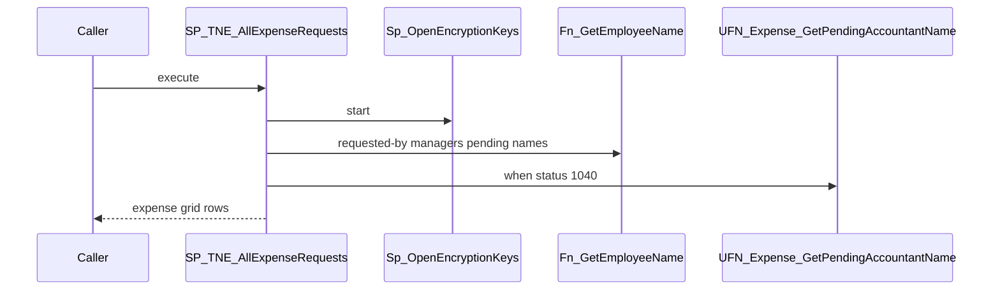
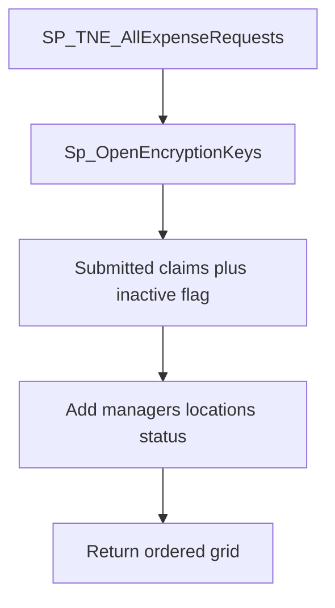

# SP_TNE_AllExpenseRequests

## What it does

Returns All Requests for submitted claims across selected employers, with optional inactive employees (`@isInactive`), business unit, employee, status, and date filters. Adds functional/reporting manager and location columns.

## Parameters

| Name | Direction | What it is for |
|---|---|---|
| `@LoginUserId` | in | Logged-in admin/viewer id |
| `@pEmployeeId` | in | Employee filter CSV |
| `@pEmployerId` | in | Employer id CSV |
| `@RequestStatus` | in | Status id CSV |
| `@StartDate` | in | Inclusive created-on start |
| `@EndDate` | in | Inclusive created-on end |
| `@BusinessUnit` | in | Business unit id CSV |
| `@isInactive` | in | When 1, include inactive employees (IsActive Y,N) |

## Call sequence

## Callers

App: `ExpenseDAL.GetExpenseRequestsWithFilters` (`SelectedTab` 3) → `ExpenseController.GetExpenseRequestsWithFilters` from [Expense Requests](/docs/guides/expense-and-reimbursement/expense-requests).

## Nested

| Object | Kind | When | Page |
|---|---|---|---|
| `Sp_OpenEncryptionKeys` | procedure | start of body | [Sp_OpenEncryptionKeys](/docs/database/hrms/Sp_OpenEncryptionKeys) |
| `Fn_GetEmployeeName` | function | requested-by / managers / pending | [Fn_GetEmployeeName](/docs/database/hrms/Fn_GetEmployeeName) |
| `UFN_Expense_GetPendingAccountantName` | function | status 1040 pending accountant | [UFN_Expense_GetPendingAccountantName](/docs/database/hrms-travelnexpense/UFN_Expense_GetPendingAccountantName) |

## Steps

1. Script is `SP_TNE_AllExpenseRequests.sql`.
2. Open encryption keys; map `@isInactive` to active flag filter string.
3. Seed submitted `TEXPENSE` into `#RRR`; build `#ExpenseData` including manager and location fields via `Fn_GetEmployeeName`.
4. Apply filters; accountant/stalled labels; return ordered grid. No close-encryption call.

## Tables

| Table | Read or write |
|---|---|
| `TEXPENSE` | read |
| `TEXPENSE_STATUS` | read |
| `TEXPENSE_PAYMENT` | read |
| `TEXPENSE_DOCUMENT` | read |
| `TLOOKUP` | read |
| `TRequestWorkflows` | read |
| `TEMAIL_NOTIFICATION` | read |
| `TEmployee` / `TEmployeeInfo` | read (synonym) |
| `TORGChart` | read (reporting manager) |
| `TOrgHierarchyDetails` | read |

## Unresolved calls

None.

## Flow

