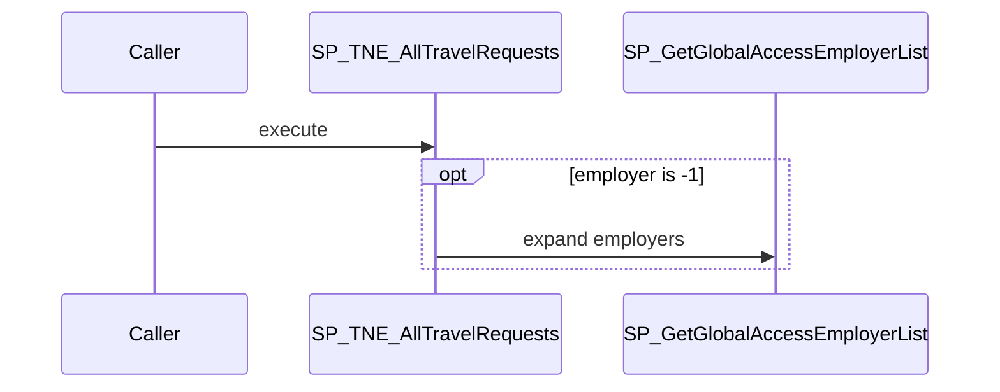
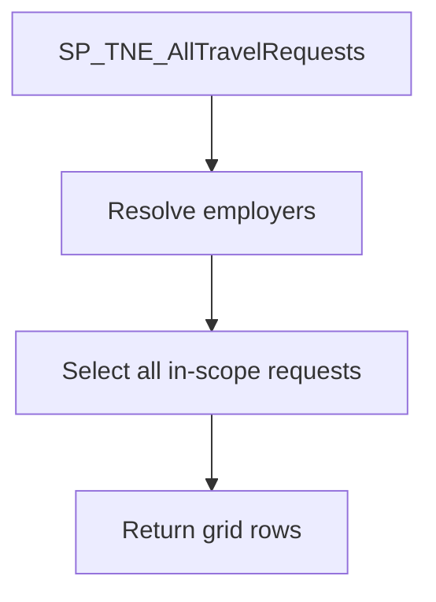

# SP_TNE_AllTravelRequests

## What it does

Returns organisation-wide travel request grid rows for the **All Requests** tab (claim-gated in UI). Same filter surface as Team Requests (employers, employees, BU, status, dates, work type, client, inactive flag) without restricting to the actor’s direct team.

## Parameters

| Name | Direction | What it is for |
|---|---|---|
| `@LoginUserId` | in | Actor used for global-access employer expansion |
| `@pEmployeeId` | in | CSV of employee ids to filter |
| `@pEmployerId` | in | Employer id, CSV, or `-1` |
| `@RequestStatus` | in | CSV of status lookup ids |
| `@StartDate` | in | Date window start |
| `@EndDate` | in | Date window end |
| `@BusinessUnit` | in | CSV of business unit ids |
| `@showInactiveEmployees` | in | Include inactive employees when 1 |
| `@WorkTypeId` | in | Optional work-type filter |
| `@ClientName` | in | Optional client-name filter |

## Call sequence

## Callers

| Caller | Page |
|---|---|
| `TravelDAL.GetTravelRequestsWithFilters` when `SelectedTab == 3` | Travel Requests guide |

## Nested

| Object | Kind | When | Page |
|---|---|---|---|
| `SP_GetGlobalAccessEmployerList` | procedure | `@pEmployerId = '-1'` | [SP_GetGlobalAccessEmployerList](/docs/database/hrms/SP_GetGlobalAccessEmployerList) |

## Steps

1. Resolve employer set and active/inactive filter.
2. Select travel requests in scope with employee/BU/status/date filters.
3. Project grid columns (type, purpose, schedule dates, status, advance, report flags).

## Tables

| Table | Read or write |
|---|---|
| `TTRAVEL_REQUEST` | read |
| `TTRAVEL_SCHEDULE` | read |
| `TTRAVEL_REQ_STATUS` | read |
| `TTRAVEL_REQ_ADVANCE` | read |
| `TLOOKUP` | read |
| `TEMPLOYEE` / `TEmployeeInfo` / `TOrgHierarchyDetails` | read |

## Unresolved calls

None beyond the nested procedure above.

## Flow

