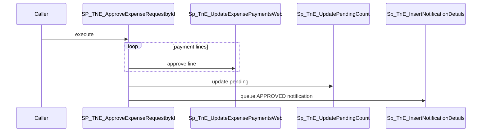
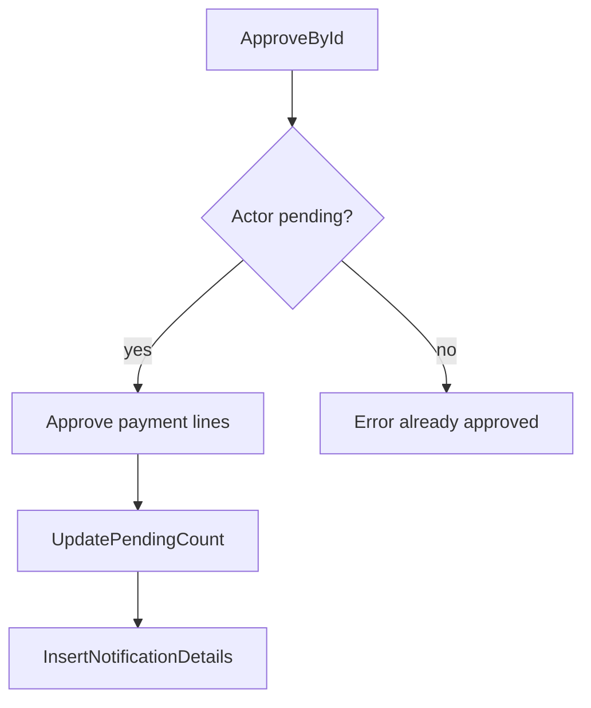

# SP_TNE_ApproveExpenseRequestbyId

## What it does

Approves a single expense request for the current pending manager. For each non-rejected payment line, calls `Sp_TnE_UpdateExpensePaymentsWeb` with approve flag, then updates pending counts and inserts notification details. If the actor is not in the pending manager list, returns a refresh/already-approved style error payload.

## Parameters

| Name | Direction | What it is for |
|---|---|---|
| `@RequestId` | in | Expense id |
| `@RequestCreatedBy` | in | Subject employee (SubmittedFor) |
| `@EmployeeId` | in | Approver |
| `@Employerid` | in | Employer of the claim |
| `@RequestType` | in | Workflow/module page name |
| `@Comments` | in | Approval comments |

## Call sequence

## Callers

| Object | Kind | Page |
|---|---|---|
| `SP_TNE_ApproveMultipleExpenseRequest` | procedure | [SP_TNE_ApproveMultipleExpenseRequest](/docs/database/hrms-travelnexpense/SP_TNE_ApproveMultipleExpenseRequest) |

## Nested

| Object | Kind | When | Page |
|---|---|---|---|
| `Sp_TnE_UpdateExpensePaymentsWeb` | procedure | per payment line when actor is pending | No page yet (level 2 from list screen) |
| `Sp_TnE_UpdatePendingCount` | procedure | after payment loop | No page yet |
| `Sp_TnE_InsertNotificationDetails` | procedure | after pending update | No page yet |

## Steps

1. Script is `SP_TNE_ApproveExpenseRequestbyId.sql`.
2. Read pending approval level and pending manager ids from `TRequestWorkflows`.
3. If actor is pending, cursor `TEXPENSE_PAYMENT` lines excluding rejected line items; call `Sp_TnE_UpdateExpensePaymentsWeb` with `'A'`.
4. Call `Sp_TnE_UpdatePendingCount` then `Sp_TnE_InsertNotificationDetails` with `APPROVED`.
5. Else build already-approved error message with custom expense id.

## Tables

| Table | Read or write |
|---|---|
| `TRequestWorkflows` | read |
| `TEXPENSE` | read |
| `TEXPENSE_PAYMENT` | read (updated via nested SP) |
| `TExpense_Line_Items` | read (reject filter) |
| `VE_TNE_ExpenseDetails` | read (reject filter) |

## Unresolved calls

None beyond the nested procedures listed (pages deferred as level 2).

## Flow

